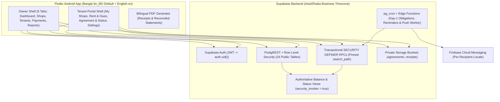

# RentFlow — Bilingual Rental & Financial Ledger Platform

**Android-First Flutter Application (`Dart 3` · `Riverpod` · `go_router` · `Material 3`) + Supabase (`PostgreSQL 15` · `RLS` · `Transactional RPCs` · `Storage` · `Edge Functions` · `pg_cron`)**

RentFlow is an authoritative, audit-grade property, shop, tenancy, and financial ledger management platform built for house and market owners in Bangladesh (`BDT ৳` · `Asia/Dhaka` · Bilingual **Bangla `bn_BD`** default & **English `en`**). It replaces manual registers and fragile spreadsheets with append-only PostgreSQL financial ledgers, multi-shop/multi-month payment allocations, snapshotted contract notice terms, permanent vacancy/occupancy history preservation, and strict Row Level Security (RLS) isolation between owners and tenants.

---

## Key Capabilities & Confirmed Business Invariants

### 1. Unrestricted Property & Shop Inventory with Permanent Occupancy History
- **No Unit Cap or Quota:** An owner can manage multiple properties/markets and an **unrestricted number of shops/units**. Zero product-defined unit limits, quota counters, or unit-cap RPCs exist anywhere in the stack.
- **Multi-Shop & Concurrent Agreements:** One tenant can rent multiple shops under one agreement or hold multiple concurrent agreements. Each shop assignment (`agreement_units`) maintains its own monthly rent snapshot and occupancy dates.
- **GiST Non-Overlap & Re-Letting:** PostgreSQL `btree_gist` exclusion constraint (`no_overlapping_active_unit_occupancy`) prevents overlapping `planned`, `active`, or historical `ended` date ranges on the same shop while allowing seamless re-letting after a non-overlapping effective date.
- **Permanent Vacancy History & Tenant Privacy:** When a shop becomes vacant, **100% of historical records** (previous tenants, agreements, rent obligations, payments, receipts, deposits, credits, adjustments, notices, and move-out settlements) are preserved in the **Owner-Only Occupancy History Timeline** (`owner_unit_occupancy_history`). A subsequent tenant who rents the same shop has **zero visibility** into prior occupants' records.

### 2. Three Strictly Separate Financial Ledgers & Atomic Payment Allocation
- **Exact Minor-Unit Money (`bigint` paisa / `int` in Dart):** Every monetary value is stored and processed as exact integer minor units (`*_minor bigint` in PostgreSQL, `int` in Dart, formatted as `৳` via `intl`). Floating-point types (`double`, `float`, `real`) are forbidden.
- **Three Never-Merged Fund Balances:**
  1. **Security Deposit (`security_deposit_transactions` / `security_deposit_balances`):** Refundable security liability scoped per agreement; **never** counted as rent income. Applying deposit to rent requires `agreements.security_deposit_application_allowed = true` (set at creation or via audited amendment), explicit owner confirmation, and a recorded reason.
  2. **Prepaid Advance Rent (`prepaid_rent_transactions` / `prepaid_rent_balances`):** Money explicitly received for future rent periods, applied only to owner-selected shop/month obligations.
  3. **Tenant Credit (`tenant_credit_transactions` / `tenant_credit_balances`):** Created **atomically in the same database transaction** whenever a posted rent payment exceeds its selected rent allocations (`received_amount_minor - sum(allocated_amount_minor)`).
- **Manual & Oldest-Due-First Allocation Proposals:** Owners can allocate a single payment across multiple shops and billing months manually (`owner_post_payment`) or request a deterministic server-side **Oldest-Due-First Proposal** (`owner_propose_oldest_due_first`, ordered by `due_date ASC, billing_period ASC, id ASC`). Proposals are read-only until reviewed and explicitly confirmed by the owner (`owner_confirm_allocation_proposal`), which re-locks and re-validates balances under `FOR UPDATE` row locks and issues a gapless per-owner receipt (`RCT-000001`).
- **Append-Only Financial Immutability:** `DELETE` and destructive `UPDATE` operations are blocked by database triggers on all financial, agreement, notice, and settlement tables (even for administrative sessions). Mistakes are corrected exclusively through audited reversal RPCs (`owner_reverse_payment`, `owner_reverse_rent_adjustment`, `owner_reverse_fund_entry`).

### 3. Snapshotted Notice Periods, Termination Workflow & Move-Out Settlement
- **Configurable 2- or 3-Calendar-Month Notice Period:** Owners configure an account-wide default (`2` or `3` calendar months) for new agreements, with optional per-agreement overrides. The agreed notice period is snapshotted onto each agreement; changing the owner default never rewrites existing signed agreements. Contract terms change only through `owner_update_agreement_terms` (writing an `agreement_amendments` record with effective date and reason).
- **Authoritative Notice Submission (`tenant_submit_termination_notice`):** Derives tenant identity strictly from `auth.uid()` and verified `tenant_profile_links` (never from client payload), records an immutable server timestamp `served_at`, calculates `minimum_effective_date` in `Asia/Dhaka` with month-end clamping (`private.add_calendar_months_clamped`), enforces `early_termination_allowed` and `partial_unit_termination_allowed`, and supports a two-step audited withdrawal workflow (`tenant_request_notice_withdrawal` -> owner confirmation).
- **Move-Out & Final Settlement (`owner_complete_move_out`):** Atomically voids unpaid future obligations after the move-out month (blocking if post-move-out months already have applied funds), applies/refunds security deposit, closes the shop assignment (`status = 'ended'`), completes linked notices, and records an immutable `move_out_settlements` snapshot.

### 4. Reconciled Accrual vs. Cash Reports, Day-1 Reminders & Complete Bilingual UX
- **Billing-Period Accrual vs. Payment-Date Cash Collection (`owner_get_financial_report`):** Strictly separates rent accrued by `billing_period` from cash collected by `payment_date` (e.g., October rent paid in November settles October's billing accrual and appears in November's cash collection). Enforces `cash_received_minor == rent_allocated_minor + tenant_credit_created_minor` and excludes security deposits from rent cash income.
- **Day-1 `Asia/Dhaka` Scheduled Reminders:** Idempotent `service_role` generators for monthly rent reminders (`generate_monthly_rent_reminders`, triggered by **actual `due_date` month** when `outstanding_minor > 0`, so arrears November rent due 5 December reminds on 1 December, never 1 November) and agreement expiry reminders (`generate_agreement_expiry_reminders`, final 3-calendar-month window), deduplicated per recipient and snapshotted in each recipient's own `preferred_locale`.
- **Independent Bangla (`bn_BD`) & English (`en`) Localization:** Launches in Bangla (`bn_BD`) by default regardless of OS locale; owner and tenant profiles control their language preference independently; verified at `1.3x` font scale on compact Android screens (`360x800` / `380x820`) and in bilingual PDF receipt/report generation (`PdfDocumentGenerator`).

---

## System Architecture



---

## Repository Structure

```text
RentFlow/
├── AGENTS.md                                      # Authoritative engineering & business rules for AI/human contributors
├── CLAUDE.md                                      # Pointer to AGENTS.md and source-of-truth precedence
├── RentFlow_Master_Blueprint.md                   # Complete 23-section product, architecture, UX, SQA & roadmap blueprint
├── pubspec.yaml                                   # Flutter 3.50 / Dart 3.14 dependencies
├── l10n.yaml                                      # Flutter ARB localization configuration
├── analysis_options.yaml                          # Strict Dart analyzer configuration (strict-casts/inference/raw-types)
├── .github/workflows/ci.yml                       # GitHub Actions CI (385 SQL checks + Flutter format/analyze/test)
├── docs/
│   ├── 01-product-requirements.md                 # PRD, user stories & acceptance criteria
│   ├── 02-architecture.md                         # Solution architecture & implemented layer notes
│   ├── 03-data-model-and-erd.md                   # PostgreSQL entities, constraints & ledger model
│   ├── 04-business-rules-and-workflows.md         # Rent calendar, allocation, notice & move-out rules
│   ├── 05-api-and-supabase-contracts.md           # RPC signatures, error codes & RLS policy contracts
│   ├── 06-notifications-and-scheduling.md         # Day-1 Asia/Dhaka reminders, deduplication & delivery worker
│   ├── 07-ui-ux-specification.md                  # Material 3 financial design system & accessibility rules
│   ├── 08-qa-and-test-plan.md                     # Test strategy, invariants & Phase 20 SQA Audit Report
│   ├── 09-roadmap-and-codex-prompts.md            # Phased delivery roadmap
│   ├── 10-decisions-and-open-questions.md         # Confirmed product decisions, ADRs & source-of-truth hierarchy
│   ├── 12-localization-specification.md           # Bangla (bn_BD) + English (en) localization specification
│   └── 13-production-deployment-and-release-runbook.md # Production deployment, security SQL audit & Android release runbook
├── supabase/
│   ├── config.toml                                # Supabase project, private buckets & Edge Function configuration
│   ├── seed.sql                                   # Idempotent private storage bucket initialization
│   ├── migrations/
│   │   ├── 0001_rentflow_core_schema.sql          # 23 core tables, *_minor bigint money, GiST occupancy exclusion
│   │   ├── 0002_rls_and_helpers.sql               # RLS on all tables, private helpers, auth.users profile trigger
│   │   ├── 0003_agreement_rpcs.sql                # owner_create_agreement, owner_update_agreement_terms, term guard
│   │   ├── 0004_rent_obligation_generation.sql    # generate_rent_obligations, advance/arrears due-date engine
│   │   ├── 0005_rent_adjustments.sql              # owner_create_rent_adjustment, reversals, never-negative guard
│   │   ├── 0006_payments.sql                      # owner_post_payment, oldest-due-first proposals, receipts, derived status
│   │   ├── 0007_fund_ledgers.sql                  # Separate security_deposit, prepaid_rent & tenant_credit ledgers
│   │   ├── 0008_termination_notices.sql           # Tenant notice submission, clamped calendar months, owner review/amend
│   │   ├── 0009_move_out_and_vacancy.sql          # owner_complete_move_out, occupancy views, hard-delete prevention
│   │   ├── 0010_reports_portal_and_reminders.sql  # Dashboard, accrual vs cash reports, tenant portal, day-1 reminders
│   │   ├── 0011_tenant_portal_linking.sql         # 8-char hashed invite codes, claim flow & audited access revocation
│   │   └── 0012_notification_delivery_and_storage.sql # Retry-safe delivery worker RPCs & private storage path guard
│   ├── functions/
│   │   ├── run-day1-scheduled-jobs/index.ts       # Day-1 Asia/Dhaka cron Edge Function
│   │   └── send-push-notifications/index.ts       # Localized FCM push delivery worker Edge Function
│   └── tests/
│       ├── package.json                           # In-process PostgreSQL (PGlite + btree_gist) test runner
│       └── run.mjs                                # 385 automated SQL, RLS, ledger, notice & global security checks
├── lib/
│   ├── main.dart                                  # App entrypoint with publishable-key security validation
│   ├── app/                                       # Material 3 theme, go_router configuration & RentFlowApp root
│   ├── core/                                      # EnvConfig, MoneyFormatter, LocaleController, ApiErrorMapper & widgets
│   ├── l10n/                                      # app_bn.arb (default) & app_en.arb + generated AppLocalizations
│   └── features/
│       ├── dashboard/                             # OwnerShellScreen (5-tab navigation & summary cards)
│       ├── units/                                 # Shops inventory, status filters & Owner-Only Occupancy History
│       ├── tenants/                               # Tenant management, 8-char portal invite & revocation dialogs
│       ├── payments/                              # Obligations, rent adjustments, Oldest-Due-First review & receipts
│       ├── reports/                               # Reconciled Billing-Accrual vs Cash-Collection reports
│       ├── notices/                               # Tenant Termination / Non-Renewal Notice submission & withdrawal
│       ├── tenant_portal/                         # TenantShellScreen, agreement details & invite code claim dialog
│       ├── notifications/                         # In-App Notification Inbox & FCM token registration
│       └── pdf_export/                            # Bilingual PDF Receipt & Financial Statement generator
└── test/
    ├── core/money_formatter_test.dart             # Minor-unit BDT formatting, Bangla/English parsing & secret guard tests
    ├── widgets/app_shell_and_l10n_test.dart       # Default bn_BD launch, 1.3x text scale & error localization tests
    └── features/
        ├── units_and_tenants_test.dart            # >10 shops (no cap), Occupancy History Timeline & portal invite tests
        ├── payments_and_allocations_test.dart     # Oldest-Due-First proposal, atomic excess credit & receipt tests
        ├── reports_and_notices_test.dart          # Accrual vs cash reconciliation & tenant notice lifecycle tests
        ├── notifications_and_pdf_test.dart        # Bilingual %PDF- generation & notification inbox tests
        └── full_journey_sqa_test.dart             # End-to-end 5-tab Owner + Tenant Portal journey at 1.3x text scale
```

---

## Authoritative PostgreSQL RPC & View Contracts

| Category | Database RPC / View | Access Scope | Purpose & Enforced Invariants |
|---|---|---|---|
| **Agreements** | `owner_create_agreement(payload)` | Owner (`authenticated`) | Validates tenant/unit ownership & `due_day` (1–28), snapshots `tenant_notice_period_months` (`2` or `3`), creates `agreements` + `agreement_units` atomically, rejects GiST date overlaps (`UNIT_NOT_AVAILABLE_FOR_DATE_RANGE`). |
| **Agreements** | `owner_update_agreement_terms(...)` | Owner (`authenticated`) | Sole permitted path to amend `expiry_date`, `due_day`, `grace_days`, `tenant_notice_period_months`, or termination/deposit flags; records `agreement_amendments` with `previous_terms`, `new_terms`, `effective_date`, and `reason`. |
| **Obligations** | `generate_rent_obligations(agreement_id, through)` | Owner (`authenticated`) | Idempotently generates monthly `rent_obligations` (`ON CONFLICT DO NOTHING`) with snapshotted rent and `advance`/`arrears` due dates (`Asia/Dhaka`, 24-month horizon cap). |
| **Adjustments** | `owner_create_rent_adjustment(...)` / `owner_reverse_rent_adjustment(...)` | Owner (`authenticated`) | Append-only shop/month debit or credit with mandatory description; rejects any change that would reduce `adjusted_payable_minor` below `0` or below already-settled amounts (`ADJUSTMENT_WOULD_NEGATE_RENT`). |
| **Payments** | `owner_propose_oldest_due_first(...)` | Owner (`authenticated`) | Read-only deterministic allocation proposal ordered by `due_date ASC, billing_period ASC, id ASC`; stores nothing until owner confirms. |
| **Payments** | `owner_post_payment(payload)` / `owner_confirm_allocation_proposal(payload)` | Owner (`authenticated`) | Locks target obligations in ID order (`FOR UPDATE`), validates `allocated <= outstanding` and `sum(allocated) <= received`, issues gapless receipt (`RCT-000001`), and atomically converts any excess into `tenant_credit_transactions`. |
| **Payments** | `owner_reverse_payment(payment_id, reason)` / `get_payment_receipt(payment_id)` | Owner / Linked Tenant | Marks payment `reversed` and reverses any excess tenant credit it created (blocked with `PAYMENT_CREDIT_ALREADY_USED` if that credit was already applied). |
| **Fund Ledgers** | `owner_record_security_deposit`, `owner_refund_security_deposit`, `owner_apply_security_deposit` | Owner (`authenticated`) | Manages per-agreement refundable security deposit; application to rent requires `security_deposit_application_allowed = true`, explicit owner confirmation, and reason. |
| **Fund Ledgers** | `owner_record_prepaid_rent`, `owner_apply_prepaid_rent`, `owner_apply_tenant_credit`, `owner_reverse_fund_entry` | Owner (`authenticated`) | Manages separate prepaid advance rent and tenant credit ledgers under tenant and obligation row locks with idempotency tracking (`fund_operations`). |
| **Notices** | `tenant_submit_termination_notice(payload)` / `tenant_request_notice_withdrawal(...)` | Verified Tenant | Derives tenant from `auth.uid()`, records immutable `served_at`, computes clamped 2/3 calendar-month `minimum_effective_date`, routes late `non_renewal` to `under_review`, and enforces `early_termination_allowed` and `partial_unit_termination_allowed`. |
| **Notices** | `owner_acknowledge_termination_notice(...)` / `owner_record_notice_dispute_or_amendment(payload)` | Owner (`authenticated`) | Records acknowledgement, dispute, mutual amendment (`agreed_termination_date` + `agreement_amendments`), or withdrawal confirmation without altering `served_at`. |
| **Move-Out** | `owner_complete_move_out(payload)` | Owner (`authenticated`) | Voids unpaid post-move-out obligations, applies/refunds deposit, closes `agreement_units` (`status = 'ended'`), completes notices, and snapshots `move_out_settlements`. |
| **Portal Link** | `owner_create_tenant_invite`, `tenant_claim_invite`, `owner_revoke_tenant_access` | Owner / Tenant | Generates 8-char single-use invite codes (stored hashed in `tenant_invites`), links verified tenant profiles, and supports audited revocation while preserving history. |
| **Reports** | `owner_get_dashboard_summary`, `owner_get_financial_report`, `tenant_get_portal_summary` | Owner / Verified Tenant | Reconciled Billing-Accrual vs. Cash-Collection reports, occupancy summaries, and zero-parameter tenant portal summary. |
| **Views** | `rent_obligation_balances`, `unit_occupancy_status`, `owner_unit_occupancy_history`, `*_balances` | `security_invoker = true` | Authoritative derived obligation statuses (`paid`, `overdue`, `due`, `partially_paid`, `upcoming`, `no_balance`, `void`), unit occupancy states, owner-only occupancy history, and separate fund balances. |
| **Schedulers** | `generate_all_rent_obligations`, `generate_monthly_rent_reminders`, `generate_agreement_expiry_reminders`, `claim_pending_notification_deliveries`, `record_notification_delivery_outcome` | `service_role` only | Idempotent day-1 `Asia/Dhaka` obligation and reminder generators and retry-safe push delivery worker (`max_attempts = 3`). |

---

## Quick Start & Verification Commands

### 1. Run the PostgreSQL Schema, RLS & Financial Invariant Suite (No Docker Required)
The SQL test suite runs all 12 migrations (`0001`–`0012`) in an in-process PostgreSQL instance (`PGlite` with `btree_gist`) and executes **385 automated assertions**:

```bash
cd supabase/tests
npm install
npm test
```

### 2. Run the Flutter Analyzer, Formatter & Bilingual Test Suite
Requires Flutter stable (`>= 3.24` / `Dart 3.4+`):

```bash
flutter pub get
flutter gen-l10n
dart format --set-exit-if-changed .
flutter analyze
flutter test
```

### 3. Run or Build the Flutter Application with Supabase
Never pass a `service_role` or `sb_secret_` key to Flutter (`EnvConfig` will reject it at startup). Pass only the project URL and publishable/anon key:

```bash
# Development run
flutter run \
  --dart-define=SUPABASE_URL=https://<your-project-ref>.supabase.co \
  --dart-define=SUPABASE_ANON_KEY=<your-publishable-anon-key>

# Production Android App Bundle (.aab)
flutter build appbundle --release \
  --dart-define=SUPABASE_URL=https://<your-project-ref>.supabase.co \
  --dart-define=SUPABASE_ANON_KEY=<your-publishable-anon-key>
```

---

## Verification & Quality Gate Status

| Quality Gate | Command | Status | Coverage Summary |
|---|---|---|---|
| **PostgreSQL Schema, RLS & Financial Invariants** | `cd supabase/tests && npm test` | **385 / 385 Passed** | 12 migrations, 24 RLS-enabled tables, 2-owner & 2-tenant isolation, concurrent agreements, GiST overlap & historical re-letting, unlimited units (>10), oldest-due-first proposals, atomic overpayment credit, 3 separate fund ledgers, clamped 2/3-month notices, move-out settlements, accrual vs. cash reconciliation, day-1 arrears reminders, portal invite hashing/revocation, delivery retries, storage path auth, and global `SECURITY DEFINER` `search_path` audit. |
| **Dart Formatting** | `dart format --set-exit-if-changed .` | **Clean (0 changed)** | All 42 Dart source and test files formatted to standard Dart style. |
| **Static Analysis** | `flutter analyze` | **Clean (0 issues)** | `strict-casts: true`, `strict-inference: true`, `strict-raw-types: true`. |
| **Flutter Unit, Widget, PDF & Full-Journey Tests** | `flutter test` | **20 / 20 Passed** | Minor-unit `৳` formatting & Bangla/English digit parsing, `service_role` key rejection, default `bn_BD` launch, runtime `bn_BD`/`en` switching, `1.3x` font scale on compact Android screens (`360x800` & `380x820`) with zero overflow, Owner-Only Occupancy History Timeline, 8-char portal invite generation/claim/revocation, Oldest-Due-First proposal review & receipt modal, accrual vs. cash report reconciliation, tenant notice submission & withdrawal, bilingual `%PDF-` byte stream generation, and full 5-tab Owner + Tenant Portal journey. |

---

## Source-of-Truth Precedence & Engineering Governance

When contributing to RentFlow, follow the governance rules in [AGENTS.md](AGENTS.md) and the source-of-truth order in [docs/10-decisions-and-open-questions.md](docs/10-decisions-and-open-questions.md):

1. **Implemented Database Migrations (`supabase/migrations/0001`–`0012`) & Automated Tests (`supabase/tests/run.mjs`, `test/`)** — authoritative schema, constraints, RLS policies, and RPC signatures.
2. **[RentFlow_Master_Blueprint.md](RentFlow_Master_Blueprint.md) & [AGENTS.md](AGENTS.md)** — confirmed product decisions, notice/vacancy/history rules, and engineering guardrails.
3. **Detailed Specification Documents (`docs/01`–`docs/13`)** — modular breakdown of requirements, architecture, ERD, workflows, API contracts, notifications, UI/UX, SQA, localization, and production deployment.
