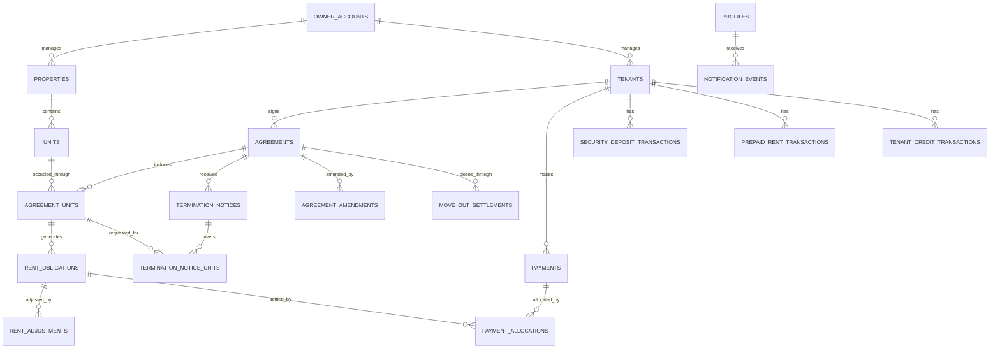

# RentFlow — Complete Product, Architecture, UX, SQA & Vibe-Coding Blueprint

**Document status:** Fresh consolidated baseline  
**Product:** RentFlow  
**Platform:** Android-first mobile application  
**Frontend:** Flutter  
**Backend:** Supabase (PostgreSQL, Auth, Storage, Edge Functions, scheduled jobs)  
**Primary market/currency:** Bangladesh / BDT (৳)  
**Timezone:** `Asia/Dhaka`  
**Languages:** Bangla and English  
**Delivery method:** Phased AI-assisted development (Codex/vibe coding), with engineering review and test gates

> **Supersedes earlier RentFlow drafts.** This document consolidates the earlier project history and approved requirements, corrects the former 10-shop/unit assumption, and adds tenant-initiated contract termination notice management and permanent occupancy history. Where earlier drafts conflict with this document, this document is the current product baseline.

---

# 1. Executive Summary

RentFlow is a professional rental-management application for a property or market owner who manages one or more properties, shops/units, tenants and rental agreements. It replaces manual notebooks and spreadsheets with a traceable system for occupancy, monthly rent obligations, payment collection, payment allocation, deposits, adjustments, agreement expiry, tenant notices, notifications and financial reports.

The product has two primary experiences:

1. **Owner portal:** Complete management of properties, shops, tenants, agreements, rent, payments, balances, notices, notifications and reports.
2. **Tenant portal:** A secure, read-only view of the tenant's own shops, agreements, rent obligations, payment receipts, balances, contract dates and notifications, with the ability to submit a contract termination/non-renewal notice according to the agreement's configured notice terms.

RentFlow must be designed as a reliable financial record system, not merely a collection of forms. Every rent obligation, payment, allocation, deposit movement, credit, adjustment, notice and occupancy change must have a traceable history.

## 1.1 Confirmed product decisions

| Topic | Product decision |
|---|---|
| Properties | An owner can manage multiple properties |
| Shops/units | No product-defined maximum number of shops/units |
| Tenants | One tenant can rent one or multiple shops |
| Rent | Each shop has its own rent amount and effective dates |
| Agreements | A tenant may have an agreement covering multiple shops; preserve individual shop assignments and their history |
| Due date | Configurable due day and payment timing for each agreement |
| Payment timing | Same-month/advance or following-month/arrears |
| Payments | One payment may cover multiple shops and multiple rental months |
| Allocation | Manual allocation and oldest-due-first proposal are both supported |
| Oldest-due-first approval | Owner must review and confirm the proposal before posting |
| Security deposit | Separate refundable balance and ledger |
| Prepaid advance rent | Separate balance and ledger |
| Tenant credit | Separate balance; excess payment becomes tenant credit automatically |
| Adjustments | Owner can add a described charge or discount to a selected shop and rental month |
| Contract expiry | Monthly reminders during the final three months; owner and linked tenant are notified |
| Tenant termination | Tenant can submit a termination/non-renewal notice using the notice period set by the owner for all tenants or overridden for an individual agreement |
| Vacant shop | Previous tenant, agreement, rent, payment, notice and ledger history must remain available permanently under the retention policy |
| Tenant portal | Tenant sees only their own data and can submit eligible notices |
| Languages | Complete Bangla and English support; each user selects their own language |
| Payment entry | Owner records offline payments (cash, bank, MFS, cheque, other) in the initial release |
| Online gateway | Not required for the initial release |

## 1.2 Explicit exclusions

- No shop/unit quota, maximum-unit rule, quota counter, quota warning, quota RPC, or unit-count restriction.
- No subscription or billing tier that changes how many units an owner can create.
- No public property marketplace.
- No automatic legal interpretation of a rental contract.
- No automatic deletion of historical tenant or financial records when a tenant leaves or a shop becomes vacant.
- No online payment gateway in the initial release unless added through a separately approved product change.

## 1.3 Product success measures

- Every occupied shop has a clear, period-specific rent obligation.
- Every payment is traceable to one or more shop/month obligations or to a clearly identified tenant-credit balance.
- Security deposit, prepaid rent and tenant credit never become indistinguishable.
- A tenant can only see their own authorized records.
- A tenant's termination notice is timestamped, auditable and linked to the applicable agreement and shops.
- A shop can become vacant and be rented again without losing any previous tenant history.
- Monthly and annual reports reconcile with posted financial transactions.
- Reminder jobs can be retried without duplicate notifications.
- Owner and tenant screens, receipts and notifications work in Bangla and English.

---

# 2. Product Roles, Personas and Permissions

## 2.1 Owner / Property Manager

The owner is the primary administrator and is responsible for:

- Creating and maintaining properties and shops/units.
- Registering tenants and linking tenant login accounts where required.
- Creating agreements and assigning one or multiple shops to a tenant.
- Setting the monthly rent for every shop assignment.
- Setting payment timing and due dates.
- Setting the default tenant termination notice period for all new agreements and, through a controlled process, applying updated terms to existing agreements.
- Setting individual notice-period overrides where a particular tenant/agreement has different terms.
- Recording rent payments and allocating them to specific shops and periods.
- Reviewing and confirming oldest-due-first allocation proposals.
- Recording security deposits, prepaid advance rent and other tenant-credit movements.
- Adding rent charges and discounts with descriptions.
- Reviewing tenant termination/non-renewal notices and coordinating move-out/final settlement.
- Closing a shop assignment while preserving historical information.
- Viewing owner-wide financial reports and audit history.

## 2.2 Tenant

A linked tenant can:

- View their own profile and rented shops.
- View agreement details, contract dates and rent terms.
- View month-wise shop rent, due dates, paid amounts and outstanding balances.
- View payment history and receipts.
- View security deposit, prepaid advance rent and tenant-credit balances separately.
- View notifications and agreement expiry reminders.
- View the applicable termination notice period.
- Submit a termination/non-renewal notice for the full agreement or, where the agreement permits it, selected shop assignments.
- View the notice submission receipt, notice timeline and owner acknowledgement/status.
- Use Bangla or English independently of the owner's selected language.

A tenant cannot change rent, edit posted payments, modify ledger entries, edit contractual terms, or see another tenant's information.

## 2.3 Optional tenant login

A tenant record may exist without a RentFlow login. The owner can invite/link the tenant later. Until a verified account is linked, the tenant does not have portal access or tenant push notifications. The owner can still manage all tenancy and financial records.

## 2.4 Authorization principles

- Flutter route guards improve UX but do not provide security.
- PostgreSQL Row Level Security (RLS) is the authority for data access.
- The backend derives the tenant identity from the authenticated user's verified profile link, not from a `tenant_id` supplied by the client.
- The owner can access only records belonging to their owner account.
- A tenant can access only records linked to their verified tenant profile.
- Sensitive actions such as payment posting, fund application, notice processing and move-out completion must use server-side validation and transactional database functions where multiple records change together.

---

# 3. Core Domain Concepts and Terminology

Use consistent terms throughout code, database, UI and documentation.

| Term | Meaning |
|---|---|
| Property | A building, market or other real-estate location managed by the owner |
| Unit / Shop | A separately rentable space within a property |
| Tenant | Person or business renting one or more units |
| Agreement | The rental contract/deed/tenancy arrangement between the owner and tenant |
| Agreement unit | One unit included in an agreement, with its own rent and occupancy dates |
| Rent period | The month for which rent is charged, independent of the payment due date |
| Rent obligation | The amount payable for one agreement-unit and one rent period |
| Payment | Money received from a tenant |
| Payment allocation | The portion of a payment applied to a specific rent obligation |
| Security deposit | Refundable deposit held separately from rent |
| Prepaid advance rent | Money explicitly received for future rent periods |
| Tenant credit | Unallocated overpayment or an approved credit available to the tenant |
| Adjustment | A documented charge or discount against a selected rent obligation |
| Termination notice | A tenant's formal notice requesting termination or non-renewal under the agreement terms |
| Move-out | Completion of occupancy for one or more agreement-unit assignments |
| Occupancy history | Permanent timeline of tenants assigned to a particular unit |

Use `agreement` consistently in end-user text where appropriate. Internal table and code names can use `tenancy` only if the team adopts that term consistently and documents the mapping.

---

# 4. End-to-End Business Workflows

## 4.1 Owner onboarding

1. Owner creates an account and verifies the chosen authentication method.
2. RentFlow creates the owner's profile and owner account.
3. Owner chooses Bangla or English.
4. Owner configures business/contact details, timezone and notification preferences.
5. Owner configures the default tenant termination notice period (2 or 3 calendar months for the initial product policy).
6. Owner adds the first property and units.
7. Owner adds tenants and creates agreements.

## 4.2 Property and shop creation

1. Owner opens Properties.
2. Owner creates or selects a property.
3. Owner adds a shop/unit with a unique code/name within that property.
4. Owner records floor/section, description, size or notes as needed.
5. The unit starts as available unless placed into maintenance/inactive status.
6. There is no product-defined count limit on properties or units.

A unit's occupancy state should be derived from active agreement-unit assignments and dates rather than by deleting/replacing unit records. A unit can be in maintenance or retired independently of occupancy history.

## 4.3 Tenant registration and agreement creation

1. Owner creates a tenant record.
2. Owner selects an existing tenant or creates a new one.
3. Owner creates an agreement with reference number, start date, expiry date, document attachment and payment terms.
4. Owner selects one or multiple available shops.
5. Owner sets a separate monthly rent amount and occupancy start date for each selected shop.
6. Owner selects the rent payment mode: same-month advance or following-month arrears.
7. Owner selects the due day and any approved grace period.
8. Owner reviews the agreement summary.
9. Owner sets or confirms the tenant termination notice period (2 or 3 calendar months according to the product configuration). The agreement stores a snapshot of this value.
10. Owner activates the agreement.
11. The system records the occupancy assignment and creates rent obligations through the approved generation process.
12. Owner may invite/link the tenant to the portal.

Do not allow overlapping active occupancy assignments for the same unit. If the business allows reserved/future occupancy, represent it explicitly with start and end dates rather than silently marking the unit occupied early.

## 4.4 Rent obligation generation

For each active agreement-unit assignment and applicable rent period:

1. Determine the billing month.
2. Read the effective rent amount for that period.
3. Calculate the actual due date from the agreement's payment mode and due day.
4. Create one rent obligation for the agreement-unit and period.
5. Snapshot the rent amount and due date so later rent changes do not rewrite historical obligations.
6. Apply approved adjustments through separate adjustment records.
7. Prevent duplicate obligations using a database uniqueness rule and idempotent generation function.

Rent period and due date are separate fields. Example: November rent can have a due date in November (advance) or December (arrears).

## 4.5 Payment collection

1. Owner opens a tenant or rent collection screen.
2. Owner records payment amount, payment date, method, reference and optional proof/document.
3. Owner selects one or multiple shop/month obligations.
4. The application shows each obligation's original amount, adjustments, previously allocated amount and remaining balance.
5. Owner allocates an amount to each selected obligation manually, or requests an oldest-due-first proposal.
6. If oldest-due-first is selected, the system calculates a proposal using current outstanding balances. The owner reviews the exact shop/month amounts and confirms.
7. The payment preview shows the total received, rent allocations and any unallocated difference.
8. When payment exceeds rent allocations, the excess becomes tenant credit in the same transaction as payment posting.
9. The system posts the payment and allocation records atomically.
10. The application displays a receipt with exact shop/month allocation details and any tenant-credit amount created.

Never infer an allocation silently. Never post a proposal before owner confirmation.

## 4.6 Security deposit collection and refund

1. Owner records a security-deposit receipt separately from a rent payment.
2. The deposit ledger stores amount, date, method, reference and related tenant/agreement.
3. The balance remains a refundable deposit liability/balance, not rent collection.
4. Owner can record a refund, with amount, date and reason.
5. Owner can apply a deposit to rent only when permitted by the agreement and explicitly authorized. The application must identify the target obligation and have an audit reason.
6. Every movement is ledger-backed and auditable.

## 4.7 Prepaid advance rent

1. Owner explicitly records money as prepaid rent for future periods.
2. The system stores it in the prepaid-rent ledger, separate from deposit and tenant credit.
3. Owner selects which future/current obligations to cover when applying it.
4. Each application links the fund movement to the rent obligation.
5. An unused balance remains visible as prepaid rent.

Do not automatically convert a security deposit into prepaid rent or tenant credit.

## 4.8 Tenant credit

1. When a posted rent payment exceeds its rent allocations, the excess automatically becomes tenant credit in the same database transaction.
2. The credit record references the originating payment.
3. The owner can later apply tenant credit to selected rent obligations or process an approved refund/adjustment if the product policy allows it.
4. Each movement is recorded in the tenant-credit ledger.

Tenant credit is not the same as prepaid advance rent. Keep their accounting and display separate.

## 4.9 Rent adjustment

1. Owner selects tenant, shop and rent period.
2. Owner selects charge/debit or discount/credit.
3. Owner enters amount and a mandatory description.
4. System shows the affected obligation and recalculated balance.
5. Owner confirms.
6. Adjustment is recorded with creator, timestamp, amount, type and target obligation.

Do not edit the original rent snapshot to represent an adjustment. Record an adjustment entry. Corrections to posted adjustments should use reversals and replacement entries.

---

# 5. Tenant Termination / Non-Renewal Notice Management

This is a core RentFlow workflow and must be designed into the database, owner portal, tenant portal, notifications, reports and test plan.

## 5.1 Owner-configurable notice period

The owner can configure:

- **Default notice period for all tenants:** 2 or 3 calendar months.
- **Agreement-specific override:** A particular agreement can use a different configured option (2 or 3 months) where the parties have agreed to it.
- **Apply-to-existing option:** The owner can review and apply a changed notice period to selected/all active agreements through an explicit, auditable agreement-term update. Do not silently rewrite previously signed agreement terms.

The notice period is stored as a snapshot on the agreement. Changing the owner's default affects new agreements unless the owner explicitly chooses an approved amendment/update process for existing agreements.

For a product setting, use a clear control such as:

- Default tenant notice period: **2 months** / **3 months**
- Apply by default to: **all new agreements**
- Existing agreements: **keep current terms** / **review and update selected agreements**

The selected 2/3-month policy must be visible on the agreement summary and tenant portal.

## 5.2 Notice types

Support two clearly labelled use cases:

1. **Non-renewal at contract expiry:** Tenant informs the owner that they do not intend to renew and will leave at the existing contract expiry date. The notice must be served by the required deadline under the agreement.
2. **Early termination request:** Tenant requests to end the agreement before its current expiry date. This is available only where the agreement permits early termination or where the owner and tenant record an approved mutual amendment.

The application must not imply that all contracts automatically permit early termination. It records the terms and requests; it does not give legal advice or decide legal enforceability.

## 5.3 Notice eligibility and deadline calculation

Each agreement stores:

- `tenant_notice_period_months` (2 or 3 for the initial product rule).
- `notice_calculation_mode` (recommended initial default: calendar months).
- Any agreed early-termination rule or restriction.
- Existing agreement start and expiry dates.

Recommended date calculation:

- Capture the server timestamp when the tenant submits the notice.
- Calculate the minimum notice date by adding the configured number of calendar months to the service date.
- If the target month has fewer days, clamp to that month's final day.
- Store the calculated result and the calculation inputs on the notice record.

Example: a notice served on 19 November with a two-calendar-month period yields a minimum date of 19 January, subject to the agreement's stated method and local contractual terms.

For non-renewal, compare the served date with the deadline needed to end at the existing expiry date. If the notice is late, show a clear warning and route the request to owner review; do not silently change the expiry date or promise that the notice is legally sufficient.

The app must show the tenant:

- Applicable notice period.
- Contract expiry date.
- Required latest notice date for non-renewal (where calculable).
- Submitted date/time.
- Requested move-out date.
- Whether the request meets the stored contractual timing rule.

## 5.4 Tenant notice submission flow

1. Tenant opens **My Agreement**.
2. Tenant selects **Submit termination / non-renewal notice**.
3. App displays the applicable notice period and contract expiry date.
4. Tenant chooses:
   - Do not renew; leave at contract expiry, or
   - Request early termination (only if enabled by the agreement).
5. If the tenant rents multiple shops, the tenant selects the full agreement or eligible shop assignment(s), subject to the agreement terms.
6. Tenant selects the intended move-out date.
7. Tenant optionally enters a reason or message.
8. App displays the notice calculation, relevant deadline and any warning.
9. Tenant confirms submission.
10. Server records the authoritative `served_at` timestamp and creates an immutable notice record.
11. Owner receives an in-app/push notification.
12. Tenant receives a submission receipt and can follow the notice status.
13. Owner acknowledges receipt or records a factual dispute/contract-term issue. Acknowledgement must not rewrite the tenant's original server timestamp.
14. Owner and tenant coordinate inspection, keys, outstanding rent, utilities/charges if applicable, deposit settlement and final statement.
15. On the effective move-out date, owner completes the move-out workflow. The affected agreement-unit assignment is closed and the shop becomes available unless it is placed into maintenance or retired.

## 5.5 Notice status lifecycle

Recommended statuses:

- `draft` — not submitted; tenant may edit.
- `submitted` — immutable notice has been served in the application.
- `acknowledged` — owner recorded receipt.
- `under_review` — timing/contract-term issue or early-termination request needs discussion.
- `mutually_amended` — parties agreed to a revised end date/term and the amendment is documented.
- `withdrawal_requested` — tenant asks to withdraw a submitted notice.
- `withdrawn` — withdrawal was recorded under the agreement's rules; preserve the original notice.
- `completed` — move-out/termination was completed and final settlement was recorded.
- `disputed` — owner or tenant has recorded a dispute requiring resolution; preserve both parties' notes.

Do not provide a destructive delete action for submitted notices. A submitted notice can only be withdrawn/cancelled through an auditable event.

## 5.6 Multi-shop agreements and partial termination

Because one tenant may rent multiple shops, the data model must support:

- A notice covering the entire agreement, or
- A notice covering selected shop assignments if partial termination is permitted by that agreement.

For partial termination, only the selected agreement-unit assignments end. Other shops under the same agreement remain active. The system must recalculate future obligations only for the affected assignments and preserve all previous obligations and allocations.

## 5.7 Owner settings and controls

Owner settings should include:

- Default tenant notice period: 2 or 3 months.
- Default applies to all new agreements.
- Per-agreement override.
- A reviewed workflow for updating existing active agreements.
- Notification recipients and channels.
- Whether partial shop termination is allowed by default for new agreements (agreement-level setting remains authoritative).

The owner must be able to view a notice calendar/list showing:

- Notice submitted date.
- Tenant.
- Property and shop(s).
- Agreement expiry.
- Required notice period.
- Requested termination date.
- Calculated earliest date / deadline status.
- Current notice state.
- Pending final settlement tasks.

## 5.8 Important legal/product boundary

RentFlow is a recordkeeping and workflow tool. The owner-entered notice period and the signed agreement must control the application's date calculation. Do not hardcode a statement that a tenant has a legal right to terminate every agreement after 2 or 3 months. Contract wording and applicable law may affect enforceability. The app should display a neutral notice-timing result and preserve supporting records; disputed or exceptional cases require human review.

---

# 6. Vacant Shops, Re-letting and Historical Data Preservation

A shop becoming vacant must never erase its previous tenant information. This is a mandatory data-integrity requirement.

## 6.1 Required behaviour

When a tenant leaves a shop:

1. Close the relevant agreement-unit assignment with an effective end date.
2. Preserve the tenant record.
3. Preserve the agreement and uploaded agreement document.
4. Preserve all rent obligations, including paid, partial, due and adjusted obligations.
5. Preserve all payment records, allocations and receipts.
6. Preserve security-deposit, prepaid-rent and tenant-credit ledger entries.
7. Preserve adjustments, notices, notices' acknowledgement/dispute timeline and move-out settlement.
8. Update the shop's current occupancy display to **Vacant** (or **Maintenance** if applicable).
9. Keep the shop record itself active and available for future rental unless the owner retires it.
10. Allow a new agreement/tenant to be associated with the same shop from a later effective start date.

## 6.2 Data model approach

Do not store the current tenant as the only tenant field on the unit and overwrite it each time. Use a historical association table such as `agreement_units` or `tenancy_unit_assignments` with:

- `unit_id`
- `agreement_id`
- `tenant_id` (directly or via agreement)
- `occupancy_start_date`
- `occupancy_end_date` (nullable while active)
- `monthly_rent_snapshot` or effective rent history reference
- `status`
- `created_at`, `created_by`, `closed_at`, `closed_by`

A unit may have many historical assignments but must not have conflicting active assignments for the same time interval.

## 6.3 Occupancy history screen

On each shop detail screen, show:

- Current status: occupied, vacant, maintenance or retired.
- Current tenant and agreement if occupied.
- **Occupancy History** timeline.
- Previous tenant names and occupancy date ranges.
- Agreement references.
- Historical rent amount for each period.
- Link to authorized historical payment/settlement summary.

Only the owner can see the full previous-tenant history. A current tenant must not see previous tenants' names, payments or documents.

## 6.4 Re-letting process

1. Owner opens the vacant shop.
2. Owner reviews the previous occupancy history (read-only historical records).
3. Owner selects **Create new agreement**.
4. Owner selects a new tenant and start date.
5. Server verifies that the new occupancy does not overlap a previous or active assignment.
6. New rent obligations are generated for the new assignment only.
7. Previous obligations and transactions remain unchanged.

## 6.5 Deletion and retention rules

- Do not hard-delete tenants, agreements, notices, rent obligations, payments, allocations or financial ledger entries through normal UI flows.
- Use archive/deactivate for master records where appropriate.
- Correct posted financial transactions using reversal entries.
- Unit deletion, if ever allowed, must be limited to a never-used draft with no agreement, obligation, payment, notice or audit reference. Otherwise retire/archive it.
- Provide an owner-controlled data retention/export policy before any future destructive data purge is introduced.

---

# 7. Rent, Due Dates and Financial Rules

## 7.1 Payment schedule modes

Each agreement stores:

- `billing_mode`: `advance` or `arrears`.
- `due_day`: recommended allowed range 1–28 to avoid month-end ambiguity.
- `grace_days`: optional, default 0 unless configured.
- timezone: `Asia/Dhaka`.

Examples:

- Advance: November 2026 rent is due by 5 November 2026.
- Arrears: November 2026 rent is due by 5 December 2026.

The due date must always be stored on the obligation, not recalculated from the current agreement setting when displaying an old month.

## 7.2 Rent period and obligation identity

Create one obligation per agreement-unit and rent period. The uniqueness rule should prevent more than one active canonical obligation for the same assignment and rental period.

Fields include:

- Agreement-unit assignment ID.
- Unit ID (directly or by join).
- Tenant ID (directly or by join).
- Billing month (`YYYY-MM-01` date or a consistent period key).
- Rent snapshot.
- Due date.
- Adjustment totals or linked adjustment rows.
- Allocated cash amount.
- Applied prepaid-rent amount.
- Applied tenant-credit amount.
- Authorized security-deposit application amount.
- Outstanding balance.
- Status.

Prefer calculating balances from authoritative postings/allocations or maintaining a transactionally updated projection with reconciliation tests. Do not allow a client to submit a trusted `outstanding_balance` value.

## 7.3 Status rules

Suggested statuses:

- `upcoming`
- `due`
- `partially_paid`
- `paid`
- `overdue`
- `void` / `waived` (owner-only controlled action with reason)

Overdue means due date has passed and outstanding is greater than zero. A paid obligation must not become overdue because the UI uses an incorrect timezone or an unrefreshed balance.

## 7.4 Proration and partial months

Initial release recommendation: do not silently prorate automatically. If a tenancy starts or ends mid-month, the owner enters the agreed partial-month amount as the rent snapshot or records an explicit adjustment with a description. Document this policy in the agreement and receipt.

This same process applies to a move-out in the middle of a month until a separate, approved proration policy is implemented.

## 7.5 Money representation

Use one exact money representation consistently. Recommended: integer paisa (`BIGINT`) for stored amounts if fractional BDT amounts may occur. If the product guarantees whole BDT only, integer BDT can be used, but the decision must be consistent across schema, calculations, PDFs and API contracts. Never use floating-point types for money.

---

# 8. Financial Ledgers and Invariants

RentFlow must maintain separate ledgers for each financial category.

## 8.1 Security deposit ledger

Tracks:

- Deposit received.
- Deposit applied to an obligation with explicit authorization.
- Deposit refunded.
- Deposit correction/reversal.

Balance = deposits received − authorized applications − refunds, adjusted by reversals.

A deposit receipt is not rent collection/revenue. Deposit reports must be separate from rent reports.

## 8.2 Prepaid advance rent ledger

Tracks:

- Future rent received explicitly as prepaid rent.
- Prepaid rent applied to specific obligations.
- Reversal/correction.
- Refund, if policy permits and owner records it.

Unused prepaid rent remains a separate balance. Do not silently merge it with security deposit or tenant credit.

## 8.3 Tenant credit ledger

Tracks:

- Excess payment created automatically by payment posting.
- Approved manual credit, if enabled.
- Application to rent obligations.
- Refund or reversal, if policy permits.

The unallocated excess from a rent payment becomes tenant credit in the same transaction as payment posting.

## 8.4 Payment allocation rules

For every posted payment:

- Total allocation to rent obligations cannot exceed each obligation's current outstanding amount.
- Total cash allocations plus tenant credit created must reconcile to the payment's received amount, except any explicitly modelled fee/withholding that is approved as a separate requirement.
- Every allocation references a specific obligation.
- An allocation cannot exceed the available payment amount.
- Posting and credit creation are atomic.
- Payment posting supports idempotency to prevent double-posting on network retry.
- Oldest-due-first proposals are calculated against current balances and must be revalidated at confirmation time.

## 8.5 Oldest-due-first proposal

Recommended order:

1. Oldest due date.
2. Oldest billing period.
3. Stable obligation ID as deterministic tie-breaker.

Only eligible outstanding obligations for the selected tenant/agreement are considered. The owner can edit the proposal before confirmation. The confirmation RPC must re-check each balance and reject stale proposals rather than over-allocate.

## 8.6 Corrections and audit

Never silently edit or delete posted financial transactions. Use:

- Reversal transaction.
- Corrected replacement transaction.
- Reason/description.
- Actor and timestamp.
- Reference to the original record.

The UI should display the original and reversal clearly so an owner can understand the audit history.

---

# 9. Recommended Data Model and ERD

This is the conceptual schema baseline. Create exact columns, types, constraints, indexes, triggers and migrations only after Codex compares it with the repository and approved implementation decisions.

## 9.1 Identity and ownership

### `profiles`
- `id` — Supabase Auth user ID.
- `full_name`.
- `phone`.
- `email` (if used).
- `preferred_locale` (`bn` or `en`).
- `created_at`, `updated_at`.

### `owner_accounts`
- `id`.
- `owner_profile_id`.
- `business_name`.
- `contact_details`.
- `timezone` default `Asia/Dhaka`.
- `default_tenant_notice_period_months` (2 or 3).
- `created_at`, `updated_at`.

### `tenant_profile_links`
- `id`.
- `tenant_id`.
- `profile_id`.
- `verified_at`.
- `created_by`.

Use a verified, unique mapping where the product requires one authenticated profile to represent one tenant. Do not let tenants self-assign arbitrary tenant IDs.

## 9.2 Property and unit inventory

### `properties`
- `id`, `owner_account_id`.
- `name`, `address`, optional description.
- `status` (`active`, `archived`).
- timestamps and audit fields.

### `units`
- `id`, `property_id`.
- `unit_code`, `display_name`, floor/section, description.
- `operational_status` (`active`, `maintenance`, `retired`).
- timestamps and audit fields.

Do not store a restrictive maximum-unit setting or enforce a unit-count quota. Current occupancy should be derived from active dated assignments; `operational_status` describes availability for use, not historical occupancy.

## 9.3 Tenants and agreements

### `tenants`
- `id`, `owner_account_id`.
- `full_name`, phone, optional email/address.
- optional identity reference (collect only if genuinely needed).
- notes, status (`active`, `archived`).
- timestamps and audit fields.

### `agreements`
- `id`, `owner_account_id`, `tenant_id`.
- `agreement_number`.
- `start_date`, `expiry_date`.
- `billing_mode` (`advance`, `arrears`).
- `due_day`, `grace_days`.
- `tenant_notice_period_months` (2 or 3 snapshot).
- `notice_calculation_mode` (initially `calendar_months`).
- `early_termination_allowed` or a more expressive agreement policy field.
- `partial_unit_termination_allowed`.
- `document_storage_path`.
- `status` (`draft`, `active`, `expiring`, `terminated`, `expired`, `archived`).
- timestamps and audit fields.

### `agreement_units`
- `id`, `agreement_id`, `unit_id`.
- `occupancy_start_date`, `occupancy_end_date`.
- `monthly_rent_amount` (effective rent snapshot for the assignment; use an effective-dated rent table if rent changes must be scheduled).
- `status` (`planned`, `active`, `ended`, `cancelled`).
- `ended_reason`, `closed_at`, `closed_by`.
- timestamps and audit fields.

If rent can change during an active assignment, add `agreement_unit_rent_rates` with `effective_from`, `effective_to`, amount and change/amendment reference. Existing rent obligations keep their historical snapshots.

## 9.4 Rent obligations and adjustments

### `rent_obligations`
- `id`, `agreement_unit_id`, `tenant_id` (or derive tenant through agreement consistently).
- `billing_period`.
- `due_date`.
- `rent_amount_snapshot`.
- `status`.
- `created_at`, `created_by`.

Unique constraint: one canonical obligation per agreement-unit and billing period.

### `rent_adjustments`
- `id`, `rent_obligation_id`.
- `adjustment_type` (`debit` / `credit`).
- `amount`.
- `description` (required).
- `created_by`, `created_at`.
- reversal/reference fields where applicable.

## 9.5 Payments and allocation

### `payments`
- `id`, `owner_account_id`, `tenant_id`.
- `payment_date`, `received_amount`.
- `method` (`cash`, `bank_transfer`, `mobile_financial_service`, `cheque`, `other`).
- `reference_number`, `note`, optional proof path.
- `status` (`draft`, `posted`, `reversed`).
- `idempotency_key`, `receipt_number`.
- `recorded_by`, `posted_at`, audit fields.

### `payment_allocations`
- `id`, `payment_id`, `rent_obligation_id`.
- `allocated_amount`.
- `created_at`, `created_by`.
- reversal/reference fields.

### `allocation_proposals`
- `id`, `payment_id` or draft collection session ID.
- `allocation_method` (`oldest_due_first`).
- proposal payload/version and status (`proposed`, `confirmed`, `stale`, `rejected`).
- reviewed/confirmed by and timestamps.

The backend must revalidate an allocation proposal at confirmation; do not trust the proposal JSON sent back by the client.

## 9.6 Separate financial ledgers

Possible implementation patterns include one typed ledger table with strict categories and constraints, or separate tables per fund type. Choose one and keep the database constraints and reporting unambiguous.

Recommended explicit tables for clarity:

- `security_deposit_transactions`
- `prepaid_rent_transactions`
- `tenant_credit_transactions`

Each contains tenant/agreement references, transaction type, amount, transaction date, description, source/reference record, creator and reversal relationship. Applications to rent must reference a specific `rent_obligation_id`.

If using a shared ledger table, require a `fund_type` enum and constraints that prevent cross-category applications. Do not use one undifferentiated `advance_balance` column.

## 9.7 Termination notice and move-out history

### `termination_notices`
- `id`, `agreement_id`, `tenant_id`.
- `notice_type` (`non_renewal`, `early_termination`).
- `served_at` (server timestamp; immutable after submission).
- `requested_termination_date`.
- `notice_period_months_snapshot`.
- `notice_calculation_mode_snapshot`.
- `minimum_effective_date` / calculated deadline result.
- `reason` (optional).
- `status`.
- `owner_acknowledged_at`, `owner_acknowledged_by`.
- `review_note`, dispute information.
- `created_at`, `created_by`.

### `termination_notice_units`
- `id`, `termination_notice_id`, `agreement_unit_id`.
- `requested_move_out_date`.
- status and completion reference.

This supports a full-agreement notice or partial shop termination where permitted.

### `agreement_amendments`
- `id`, `agreement_id`.
- amendment type (notice-period change, rent change, expiry change, permitted early termination, etc.).
- previous terms snapshot and new terms snapshot.
- effective date.
- supporting document path / acknowledgement data if required.
- created_by, approved_by and timestamps.

### `move_out_settlements`
- `id`, agreement_id, tenant_id.
- effective move-out date.
- final rent/adjustment summary.
- deposit refund/application summary.
- keys/inspection/notes fields if required.
- settlement status and audit fields.

Do not make settlement a destructive replacement of ledger information; it is a summary referencing the underlying transactions.

## 9.8 Notifications and devices

### `notification_events`
- `id`, recipient profile ID, event type.
- language snapshot.
- title/body or localization key + parameters.
- related entity type/id.
- unique deduplication key.
- status, created_at, read_at.

### `notification_deliveries`
- `id`, notification_event_id.
- channel (`in_app`, `push`, optional future channels).
- delivery status, attempt count, last error, timestamps.

### `device_tokens`
- profile ID, FCM token, platform, last_seen_at, active flag.

## 9.9 Conceptual ERD



---

# 10. Supabase Architecture and API/RPC Contracts

## 10.1 Stack responsibilities

### Flutter
- Presentation and user interaction.
- Form-level validation and friendly error display.
- App state and navigation.
- Localization, date and currency formatting.
- Supabase client calls and secure file upload workflows.

### Supabase Auth
- Owner and tenant authentication.
- Session lifecycle and account recovery.
- Verified user identity.

### PostgreSQL
- Source of truth for all domain data.
- Referential integrity, check constraints and unique constraints.
- RLS policies.
- Transactional RPCs for financial and multi-record workflows.
- Reporting views/functions.

### Supabase Storage
- Private agreement/deed documents.
- Private payment proof files.
- Generated receipts/statements if persisted.
- Access granted through owner/tenant policies or short-lived signed URLs.

### Edge Functions and scheduled jobs
- Notification orchestration.
- FCM delivery.
- Scheduled rent reminders and agreement/notice reminders.
- Retry/error handling.
- Other server-only integrations.

## 10.2 Recommended RPC/function contracts

Use typed, version-controlled contracts. Names below are illustrative and should be standardized before implementation.

| Function | Purpose | Required security behaviour |
|---|---|---|
| `owner_create_agreement(...)` | Create agreement and associated shop assignments | Verify owner ownership; validate unit availability; transactionally create all records |
| `owner_update_agreement_terms(...)` | Create an auditable amendment | Preserve old terms; record effective date and actor |
| `generate_rent_obligations(period)` | Generate obligations for eligible assignments | Idempotent; no duplicate period rows; server-controlled |
| `owner_post_payment(payload)` | Post payment, allocations and excess credit | Lock/revalidate balances; idempotency; atomic commit/rollback |
| `owner_propose_oldest_due_first(...)` | Calculate allocation proposal | Read current eligible obligations; deterministic ordering |
| `owner_confirm_allocation_proposal(...)` | Confirm and post reviewed allocations | Revalidate current balances and payment amount; atomic |
| `owner_record_security_deposit(...)` | Record deposit receipt/refund/application | Separate ledger; explicit authorization and audit reason |
| `owner_record_prepaid_rent(...)` | Record prepaid rent receipt | Separate ledger and owner authorization |
| `owner_apply_prepaid_rent(...)` | Apply prepaid balance to obligations | Lock fund balance and obligations; prevent over-application |
| `owner_apply_tenant_credit(...)` | Apply tenant credit to obligations | Lock fund balance and obligations; prevent over-application |
| `owner_create_rent_adjustment(...)` | Add charge/discount | Validate target obligation and owner scope; require description |
| `tenant_submit_termination_notice(...)` | Submit tenant termination/non-renewal notice | Derive tenant from `auth.uid()`; calculate dates server-side; persist server timestamp |
| `owner_acknowledge_termination_notice(...)` | Acknowledge tenant notice | Verify owner scope; append event; never rewrite served timestamp |
| `owner_record_notice_dispute_or_amendment(...)` | Record issue or mutually agreed amendment | Preserve original notice and prior agreement terms |
| `owner_complete_move_out(...)` | Close selected agreement-unit assignments and record settlement | Validate dates; preserve history; prevent overlapping future occupancy |
| `owner_get_dashboard_summary(...)` | Return owner dashboard metrics | Owner-scope authorization and consistent reporting definitions |
| `tenant_get_portal_summary(...)` | Return tenant portal metrics | Derive tenant link from authenticated profile; no client-supplied tenant authority |

## 10.3 Example tenant notice request

Client request should contain only the requested action and user-entered fields. The server derives the tenant and authoritative timestamp.

```json
{
  "agreement_id": "uuid",
  "notice_type": "non_renewal",
  "requested_termination_date": "2027-03-31",
  "agreement_unit_ids": ["uuid-1", "uuid-2"],
  "reason": "I plan to vacate the rented shops."
}
```

The server must:

1. Authenticate the tenant.
2. Resolve the verified tenant profile link.
3. Verify that the tenant is a party to the agreement.
4. Verify the selected agreement-unit assignments belong to that agreement.
5. Verify partial termination is permitted if only selected shops are included.
6. Read the agreement's notice period and calculation mode from the database.
7. Calculate eligibility/deadline using server date logic.
8. Store immutable `served_at` from the server clock.
9. Create notice and unit rows in one transaction.
10. Create notification events for the owner and the tenant.

Do not trust `tenant_id`, `notice_period_months`, `served_at`, `minimum_effective_date` or an owner ID sent by Flutter.

## 10.4 Error contract

Use stable machine-readable error codes and localized client messages. Examples:

- `NOT_AUTHORIZED`
- `TENANT_PROFILE_NOT_LINKED`
- `AGREEMENT_NOT_ACTIVE`
- `UNIT_NOT_AVAILABLE_FOR_DATE_RANGE`
- `NOTICE_NOT_ALLOWED_BY_AGREEMENT`
- `NOTICE_PERIOD_NOT_MET`
- `PARTIAL_TERMINATION_NOT_ALLOWED`
- `PAYMENT_ALREADY_POSTED`
- `PAYMENT_ALLOCATION_EXCEEDS_OUTSTANDING`
- `INSUFFICIENT_TENANT_CREDIT`
- `INSUFFICIENT_PREPAID_RENT`
- `SECURITY_DEPOSIT_APPLICATION_NOT_AUTHORIZED`
- `IDEMPOTENCY_CONFLICT`

There must be no unit-quota error code or quota-related function.

## 10.5 RLS design checklist

- Enable RLS on all private tables.
- Owner SELECT/INSERT/UPDATE/DELETE policies must verify the authenticated user owns the related `owner_account_id`.
- Tenant SELECT policies must resolve the tenant link from `auth.uid()` and constrain access through tenant/agreement relationships.
- Tenants cannot directly insert/update payment, allocation, deposit or ledger rows.
- Submitted notices are created through a secure function; tenant may read their own notices and request a supported withdrawal workflow.
- Owner acknowledgement and move-out completion must verify owner scope.
- Storage policies must prevent cross-owner and cross-tenant document access.
- Test direct PostgREST access, not only Flutter screens.
- Avoid using security-definer functions without a fixed safe `search_path`, explicit authorization checks and careful privilege review.

---

# 11. Notification and Scheduling Design

Use Asia/Dhaka as the business timezone for date-based schedules. Persist event timestamps consistently (UTC `timestamptz`) and calculate local calendar dates in the configured timezone.

## 11.1 Monthly rent reminder

- Run on day 1 of each month.
- Select obligations whose **actual due date** is in that calendar month and whose outstanding amount is greater than zero.
- Notify owner and linked tenant according to preferences.
- Include rent period, shop breakdown, amount due, due date and current status.
- Do not remind in November for an arrears-mode November obligation due in December merely because the billing period is November.
- Deduplicate per recipient, obligation/reminder period and event type.

## 11.2 Agreement expiry reminder

- Run monthly on day 1.
- Notify when expiry falls within the agreed final three-calendar-month window.
- Notify owner and linked tenant.
- If no tenant account is linked, notify owner only.
- Deduplicate per recipient/agreement/month.
- Show an in-app warning on the agreement screen during the same window.

## 11.3 Termination notice notifications

Notify:

- Owner when a tenant submits a notice.
- Tenant when the notice is successfully submitted.
- Tenant when owner acknowledges it or records a response.
- Both parties when an amendment, agreed date change, dispute or completion is recorded, according to their preferences.
- Owner and tenant before any relevant notice deadline or move-out date where reminders are enabled.

All notifications must use the recipient's own language preference. A language snapshot may be stored with each generated notification so later preference changes do not rewrite historical messages.

## 11.4 Notification delivery architecture

1. Business transaction writes a durable notification event.
2. Scheduled/Edge Function worker reads pending events.
3. Worker creates/updates delivery attempt records.
4. In-app notification is available from the database.
5. FCM sends push notifications to active device tokens.
6. Retry transient errors with bounded backoff.
7. Mark permanent failures and expose monitoring/diagnostics.

Deduplication must be enforced with a unique key in PostgreSQL. Do not rely on a Flutter-side check.

---

# 12. Localization and Bangladesh UX Requirements

## 12.1 Localization stack

Use Flutter localization generation with:

- `flutter_localizations`
- `intl`
- ARB resources (`app_en.arb`, `app_bn.arb`)
- Generated localization accessors

Suggested structure:

```text
app/
  l10n.yaml
  lib/
    core/
      localization/
        locale_controller.dart
        locale_repository.dart
    l10n/
      app_en.arb
      app_bn.arb
```

## 12.2 Requirements

- Bangla is the initial app default; English is fully supported.
- Owner and tenant preferences are independent.
- Save preference to the authenticated user's profile and cache locally for startup UX.
- Translate screen labels, forms, validation, dialog text, errors, empty states, buttons, notifications, receipts and reports.
- Localize month names, date presentation and numeric formatting.
- Display BDT with `৳` consistently.
- Decide and apply one date convention across the app; allow the user to see unambiguous dates in both languages.
- Support Unicode Bangla fonts in PDF generation.
- Do not store translated status strings in PostgreSQL. Store stable enum/code values and translate in Flutter.
- Do not concatenate translated fragments where a complete localized sentence is required; use parameterized localization messages.

## 12.3 Example labels

| English | Bangla |
|---|---|
| Dashboard | ড্যাশবোর্ড |
| Properties | প্রপার্টি |
| Shops | দোকানসমূহ |
| Vacant | খালি |
| Occupied | ভাড়াকৃত |
| Occupancy History | দখল/ভাড়ার ইতিহাস |
| Tenants | ভাড়াটিয়া |
| Agreements | চুক্তিসমূহ |
| Rent Due | বকেয়া ভাড়া |
| Paid Rent | পরিশোধিত ভাড়া |
| Security Deposit | জামানত |
| Prepaid Rent | অগ্রিম ভাড়া |
| Tenant Credit | ভাড়াটিয়ার জমা ক্রেডিট |
| Payment History | পেমেন্টের ইতিহাস |
| Termination Notice | চুক্তি বাতিলের নোটিশ |
| Non-renewal Notice | চুক্তি নবায়ন না করার নোটিশ |
| Notice Period | নোটিশের সময়সীমা |
| Requested Move-out Date | দোকান ছাড়ার প্রস্তাবিত তারিখ |
| Monthly Report | মাসিক প্রতিবেদন |
| Yearly Report | বার্ষিক প্রতিবেদন |

---

# 13. Professional UI/UX Design Specification

The design should feel like a modern, trustworthy financial-management product: clear, calm, efficient and transparent. Avoid a cluttered spreadsheet appearance and avoid excessive dashboard cards.

## 13.1 Design principles

- **Financial clarity:** Paid, due, overdue, deposit, prepaid rent and tenant credit must be visually distinguishable.
- **Action-first:** Frequent owner tasks (collect rent, add tenant, add shop, create agreement) should be easy to reach.
- **Progressive disclosure:** Show summaries first and detailed allocation/ledger data on drill-down.
- **Trust:** Confirm before posting financial transactions or submitting irreversible business events.
- **History-first:** A vacant shop still has a visible occupancy timeline.
- **Inclusive localization:** Design for Bangla text length and typography from the start; do not treat Bangla as a last-minute translation.
- **Accessibility:** Minimum comfortable touch targets, adequate contrast, semantic labels and readable typography.
- **Responsive:** Support compact Android phones and larger displays without clipping or horizontal overflow.

## 13.2 Visual system

Use Material 3 foundations with a custom RentFlow theme. Before implementation, define design tokens for:

- Brand primary and secondary colours.
- Surface/background levels.
- Text hierarchy.
- Success, warning, danger and informational semantic colours.
- Spacing scale.
- Corner radius scale.
- Elevation and borders.
- Typography for Bangla and English.
- Icon sizes and button heights.

Suggested semantic status mapping:

- Paid/completed: success.
- Due/upcoming: neutral/informational.
- Overdue/action required: danger.
- Pending review/notice: warning.
- Vacant: neutral.
- Occupied: primary/informational.

Do not communicate status by colour alone; always include a text label and accessible semantics.

## 13.3 Owner navigation

Use a bottom navigation for the most frequent areas and a drawer/More section for secondary features. Suggested primary destinations:

1. Home
2. Properties
3. Tenants
4. Payments
5. Reports

Secondary destinations:

- Agreements
- Rent calendar
- Termination notices
- Notifications
- Settings

Adapt based on UX testing; do not place too many tabs in the bottom bar.

## 13.4 Tenant navigation

1. Home
2. My Shops
3. Rent & Payments
4. My Agreement
5. Profile / More

The tenant's notice workflow should be discoverable from **My Agreement**, with the notice period and expiry visible before submission.

## 13.5 Owner screens

### Dashboard
- Month selector.
- Expected rent for selected month.
- Received rent for selected month.
- Outstanding and overdue totals.
- Recent collections.
- Upcoming due obligations.
- Agreements approaching expiry.
- Pending tenant termination notices.
- Quick actions: collect payment, add tenant, add shop, create agreement.

### Properties list
- Property name/address.
- Occupied/vacant summary.
- Search and filter.
- Add property.

### Property detail
- Unit grid/list.
- Occupied/vacant/maintenance status.
- Property-level collection summary.
- Search and filter by shop code/status.

### Shop detail
- Current status and tenant, if occupied.
- Current agreement and rent.
- Outstanding balance shortcut.
- **Occupancy History** timeline.
- Previous tenant/agreement drill-down for owner only.
- Create new agreement when vacant.

### Tenant list and profile
- Search by name/phone.
- Active/inactive status.
- Current rented shops.
- Contact details.
- Agreements and history.
- Separate financial balances.
- Linked portal status.

### Agreement detail
- Parties and selected shops.
- Rent amount per shop.
- Billing mode and due day.
- Start/expiry dates.
- Tenant notice period (global default or individual override).
- Early/partial termination permissions.
- Uploaded deed/document.
- Amendments and activity timeline.
- Termination notices and move-out history.

### Payment collection
Use a guided multi-step flow:
1. Select tenant.
2. Select obligations (shop/month).
3. Choose manual allocation or oldest-due-first proposal.
4. Review allocations.
5. Review excess/credit.
6. Confirm and post.
7. View/share receipt.

### Financial account detail
Show separate tabs/sections for:
- Rent obligations and allocations.
- Security deposit ledger.
- Prepaid rent ledger.
- Tenant-credit ledger.

### Termination notice management
- List by pending, acknowledged, under review, completed and disputed.
- Tenant/agreement/shop details.
- Served date and requested end date.
- Notice period snapshot and date calculation.
- Acknowledge, add response, record amendment, prepare move-out settlement.
- Never delete submitted notices.

### Reports
- Monthly/annual overview.
- Rent due versus collected.
- Collection by payment date.
- Shop-wise and tenant-wise statements.
- Outstanding and overdue.
- Deposit, prepaid rent and credit balances.
- Occupancy history and vacant-unit report.
- Agreement expiry and notice report.

## 13.6 Tenant screens

### Tenant home
- Current outstanding.
- Next due date.
- Rented shops.
- Recent payments.
- Upcoming expiry/notice deadline.
- Notifications.

### My shops
- Each shop's rent amount.
- Occupancy period.
- Current balance.
- Agreement link.

### My agreement
- Contract dates.
- Rent/payment terms.
- Notice period.
- Non-renewal deadline.
- Early termination eligibility message.
- Submit notice action.
- Notice history and owner responses.

### Payment history
- Date, amount, method, receipt number.
- Shop/month allocation breakdown.
- Download/share receipt.

### My balances
- Security deposit.
- Prepaid advance rent.
- Tenant credit.
- Each balance's movement history and descriptions.

## 13.7 UI states and interaction patterns

Every list/detail form should include:

- Loading state/skeleton.
- Empty state with a clear next action.
- Error state with retry and helpful message.
- Success feedback.
- Permission-denied state.
- Offline/no-connection handling.
- Confirmation for financial posting, notice submission, agreement amendment and move-out completion.

Avoid showing a success message before the server confirms the transaction.

---

# 14. Reporting and Reconciliation

Keep rent accrual reports separate from cash collection reports.

## 14.1 Owner reports

- Monthly expected rent by billing period.
- Monthly received cash by payment date.
- Month-wise allocated rent.
- Outstanding and overdue rent as of a selected date.
- Tenant-wise statement.
- Shop-wise statement.
- Annual rent billed/collected/outstanding.
- Payment-method breakdown.
- Security deposit received/applied/refunded/balance.
- Prepaid rent received/applied/balance.
- Tenant credit created/applied/refunded/balance.
- Agreement expiry report.
- Tenant termination notice report.
- Occupancy history and vacant-shop report.

## 14.2 Tenant reports

- Own shop-wise rent statement.
- Own monthly obligations and payments.
- Own receipts.
- Own deposit/prepaid/credit statements.
- Own agreement and notice history.

## 14.3 Reconciliation rules

- Reported rent collected must reconcile with posted payment allocations, not the full cash receipt if some cash became tenant credit.
- Cash received must reconcile to rent allocations plus tenant credit created and any other explicitly modelled split.
- Security deposit receipts/refunds/applications reconcile to the security-deposit ledger.
- Prepaid rent balances reconcile to prepaid-rent receipts/applications/refunds.
- Tenant credit reconciles to excess payments and approved credit movements less applications/refunds/reversals.
- Outstanding rent reconciles to obligation amounts, adjustments and valid allocations/applications.
- Voids, reversals and corrections must be handled consistently in every report.

PDFs and exports must show report date, selected period, currency, filters, and a clear distinction between billing period and cash payment date.

---

# 15. Security, Privacy, Reliability and Operational Requirements

## 15.1 Security

- Enforce RLS on all private business tables.
- Use least-privilege roles and policies.
- Keep service-role keys only in trusted server environments.
- Protect private storage buckets with owner/tenant-specific authorization.
- Validate every RPC argument on the server.
- Use safe `SECURITY DEFINER` practices only where necessary.
- Avoid returning unnecessary identity information in tenant APIs.
- Record sensitive financial and agreement actions in audit history.

## 15.2 Privacy

- Collect only necessary tenant data.
- Make sensitive identity fields optional unless the owner's actual business/legal workflow requires them.
- Provide controlled access to agreement and payment documents.
- Do not expose previous tenants' details to current tenants.

## 15.3 Reliability

- Use database transactions for payment posting, ledger application, notice submission and move-out closing.
- Use idempotency keys for retriable writes.
- Lock or otherwise serialize critical balance updates.
- Make scheduled jobs idempotent.
- Preserve financial history.
- Add monitoring for failed notification jobs and database function errors.

## 15.4 Performance

- Index common filters: owner, tenant, property, unit, agreement, billing period, due date and status.
- Paginate long histories.
- Avoid loading every payment/obligation into a mobile list at once.
- Use dashboard aggregate queries/views rather than many independent round trips.
- Profile screens on real Android devices and typical Bangladesh mobile networks.

## 15.5 Backup and recovery

- Choose Supabase backup/PITR capability according to the production plan and risk tolerance.
- Document export/restore steps for critical records.
- Test restore procedures before production launch.
- Keep database migrations in Git.
- Never make a destructive production migration without a reviewed backup and rollback/recovery plan.

---

# 16. SQA Strategy and Detailed Test Plan

Act as a senior SQA engineer throughout development. Every feature phase must include tests before it is considered complete.

## 16.1 Test layers

1. **Unit tests:** Date calculation, money calculation, localization formatting, validation and state logic.
2. **Widget tests:** Forms, screens, dialogs, navigation and accessibility semantics.
3. **Repository tests:** Supabase query mapping, error handling and retry behaviour.
4. **Database tests:** Constraints, functions, triggers, uniqueness and transaction rollback.
5. **RLS tests:** Owner isolation, tenant isolation, unauthorized writes and cross-tenant access.
6. **Integration tests:** Full flows across Flutter and Supabase.
7. **End-to-end tests:** Owner and tenant journeys on Android.
8. **Regression tests:** Re-run all critical tests after schema or financial changes.
9. **Usability/accessibility tests:** Bangla/English, TalkBack, text scaling, touch targets and layout overflow.
10. **Operational tests:** Scheduled job retries, FCM delivery failures, backup and restore.

## 16.2 Critical functional test scenarios

### Inventory and history
- Create multiple properties and an unrestricted number of shops.
- Create and archive properties/units.
- Assign a shop to Tenant A, end occupancy, and assign it to Tenant B later.
- Verify Tenant A's agreement, obligations, payments, receipts, deposit and notice history remain accessible to the owner.
- Verify Tenant B cannot see Tenant A's historical information.
- Verify overlapping active occupancy is rejected.
- Verify a vacant shop is shown as available and can be re-let.

### Tenant and agreement
- One tenant rents one shop.
- One tenant rents multiple shops with different rent amounts.
- Agreement start/expiry date validation.
- Due day and advance/arrears calculations.
- Rent change creates future effective terms without altering historical obligation snapshots.

### Termination notice
- Owner sets default notice period to 2 months; new agreement inherits 2 months.
- Owner changes default to 3 months; previously signed agreement retains its snapshot unless explicitly amended.
- Owner updates a selected active agreement with an auditable amendment.
- Tenant submits non-renewal notice within the required deadline.
- Tenant submits notice after the deadline; app warns and routes for review without changing expiry silently.
- Tenant attempts early termination when the agreement does not allow it.
- Tenant submits a permitted early-termination request.
- Tenant submits notice for all shops in an agreement.
- Tenant submits notice for one shop where partial termination is allowed.
- Owner acknowledges the notice; original `served_at` remains unchanged.
- Owner records a dispute or amendment; original notice remains in history.
- Tenant requests withdrawal; system records withdrawal as an event and preserves the original notice.
- Repeated submission/retry does not create duplicate notices.
- Unauthorized tenant cannot submit notice for another tenant's agreement.

### Payments and financial integrity
- Full payment for one shop/month.
- Partial payment.
- One payment covers multiple months and multiple shops.
- Manual allocation.
- Oldest-due-first proposal and owner confirmation.
- Proposal becomes stale after a concurrent payment; confirmation revalidates and safely fails/recalculates.
- Excess amount becomes tenant credit atomically.
- Duplicate payment request with same idempotency key does not double post.
- Transaction failure rolls back payment and all allocation/credit rows.
- Security deposit receipt, authorized application and refund.
- Prepaid rent receipt and application.
- Tenant-credit application.
- Adjustment charge and discount.
- Reversal and replacement entries.
- No fund category can be applied using another fund category's balance.

### Notifications
- Rent reminder only for obligations due in the current due-date month.
- Arrears-mode rent is not reminded in the wrong month.
- Agreement reminders fire within the final three-calendar-month window.
- Owner and linked tenant receive notice-related events.
- Unlinked tenant does not receive push but owner is notified.
- Duplicate scheduler run creates no duplicate event/delivery.
- Failed FCM delivery is retried and recorded.
- Bangla and English notification content follows each recipient's preference.

### Localization and UI
- Every screen tested in Bangla and English.
- Long Bangla labels do not overflow.
- Currency/number/date formatting is correct.
- PDF Bangla fonts render properly.
- Text scaling and TalkBack labels work.
- Loading/empty/error/success states are present.

## 16.3 Financial invariants to assert in tests

- No posted allocation exceeds the payment amount.
- No posted allocation exceeds the obligation's available outstanding amount.
- Payment total equals rent allocations plus tenant credit created plus any explicitly modelled splits.
- Posted payment, allocations and overpayment-credit creation are atomic.
- Security deposit balance never changes due to ordinary rent allocation unless an authorized deposit application exists.
- Prepaid rent and tenant credit remain separate.
- Reversed entries do not disappear from audit history.
- Every rent obligation is unique for its agreement-unit and billing period.
- No current unit assignment overlaps another active assignment for the same unit.
- Closing occupancy never deletes historic records.
- Notice period and served timestamp on a submitted notice cannot be changed by ordinary update operations.

## 16.4 Release gates

Do not release if any of the following remain:

- Critical or high-severity tenant data exposure.
- Financial posting inconsistency.
- Duplicate payment or allocation risk.
- Missing reversal/audit trail for posted financial records.
- Incorrect tenant termination date calculation.
- Loss of previous tenant history during move-out/re-letting.
- Duplicate notification creation on scheduler retry.
- Bangla rendering failures in core workflows or receipts.

---

# 17. Monorepo and Flutter Project Structure

Recommended starting structure; keep it practical and adapt only with an explicit reason.

```text
rentflow/
├── AGENTS.md
├── README.md
├── CHANGELOG.md
├── .gitignore
├── docs/
│   ├── 01-product-and-scope.md
│   ├── 02-business-workflows.md
│   ├── 03-architecture.md
│   ├── 04-data-model-and-erd.md
│   ├── 05-financial-rules.md
│   ├── 06-termination-and-occupancy-history.md
│   ├── 07-api-and-rls-contracts.md
│   ├── 08-localization.md
│   ├── 09-ui-ux.md
│   ├── 10-notifications.md
│   ├── 11-sqa-test-plan.md
│   ├── 12-deployment.md
│   └── 13-codex-roadmap.md
├── app/
│   ├── pubspec.yaml
│   ├── analysis_options.yaml
│   ├── l10n.yaml
│   ├── lib/
│   │   ├── main.dart
│   │   ├── app.dart
│   │   ├── core/
│   │   │   ├── config/
│   │   │   ├── constants/
│   │   │   ├── errors/
│   │   │   ├── localization/
│   │   │   ├── routing/
│   │   │   ├── theme/
│   │   │   ├── utils/
│   │   │   └── widgets/
│   │   ├── shared/
│   │   │   ├── models/
│   │   │   ├── repositories/
│   │   │   └── services/
│   │   └── features/
│   │       ├── auth/
│   │       ├── owner_dashboard/
│   │       ├── properties/
│   │       ├── units/
│   │       ├── occupancy_history/
│   │       ├── tenants/
│   │       ├── agreements/
│   │       ├── rent_obligations/
│   │       ├── payments/
│   │       ├── security_deposits/
│   │       ├── prepaid_rent/
│   │       ├── tenant_credit/
│   │       ├── rent_adjustments/
│   │       ├── termination_notices/
│   │       ├── move_out/
│   │       ├── tenant_portal/
│   │       ├── notifications/
│   │       ├── reports/
│   │       └── settings/
│   ├── test/
│   └── integration_test/
├── supabase/
│   ├── config.toml
│   ├── migrations/
│   ├── seed.sql
│   ├── functions/
│   │   ├── notification-worker/
│   │   ├── rent-reminders/
│   │   ├── agreement-expiry-reminders/
│   │   └── report-export/
│   └── tests/
└── scripts/
    ├── verify.sh
    └── local-setup.sh
```

Each feature should use clear presentation, domain and data separation where it materially improves testability. Do not create abstractions just to satisfy a folder diagram.

---

# 18. Step-by-Step Vibe-Coding Roadmap

## 18.1 Standard workflow for every phase

For every Codex task:

1. **Read:** Inspect `AGENTS.md`, this blueprint and relevant existing files.
2. **Understand:** Restate the exact feature scope and acceptance criteria.
3. **Inspect:** Review current code/schema before changing it.
4. **Plan:** List files, migrations, dependencies, security effects and tests.
5. **Implement:** Work only on the approved phase; do not expand scope silently.
6. **Test:** Run formatter, static analysis, unit/widget/database/integration tests relevant to the change.
7. **Review:** Inspect the diff for regressions, access-control gaps and data-loss risks.
8. **Document:** Update the relevant docs and record any decision.
9. **Commit:** Create one focused commit after the phase passes.
10. **Report:** Summarize changed files, migrations, tests, limitations and next phase.

Ask Codex to stop and report if it finds a conflict between the actual repository and this specification. Do not let it silently redesign financial or contractual rules.

## Phase 0 — Repository and history audit

**Goal:** Understand existing files and establish the current source of truth before coding.

**Codex prompt:**

```text
Act as a senior software architect and technical product analyst for RentFlow.

First inspect the entire existing repository, all Markdown documentation, Flutter
source, Supabase migrations, functions, tests and Git status. Do not modify code
in this phase.

Compare the existing repository with the RentFlow Complete Product, Architecture,
UX, SQA and Vibe-Coding Blueprint supplied in this project. Produce a gap report:
- existing features and implementation status
- conflicting or obsolete requirements
- database and RLS gaps
- financial integrity risks
- tenant termination/non-renewal workflow gaps
- missing occupancy history and historical retention
- localization gaps
- UI/UX and accessibility gaps
- missing automated tests

The current product has no shop/unit maximum or quota. Remove the former 10-unit
assumption from the implementation plan; do not add a count limit, counter,
quota RPC, quota warning or quota error.

Preserve confirmed historical requirements: one tenant can rent multiple shops;
each shop has its own rent; multi-shop/multi-month payments; manual and
owner-confirmed oldest-due-first allocation; separate security deposit, prepaid
rent and tenant credit; excess payment becomes tenant credit; reminders; owner
and tenant portals; Bangla and English; and permanent previous-tenant history.

Do not implement anything yet. Return a prioritized remediation plan and list
questions only where the specification is genuinely unresolved.
```

**Gate:** Repository status and gap report approved; no code changes.

## Phase 1 — Finalize product documents and `AGENTS.md`

**Goal:** Make the product requirements available to every later Codex task.

**Codex prompt:**

```text
Act as a senior product architect, Flutter lead, Supabase/PostgreSQL architect,
UI/UX designer and SQA lead.

Create/update the project documentation from the approved RentFlow blueprint.
Create AGENTS.md with non-negotiable business and engineering rules.

Make the following requirements explicit:
- no product-defined limit on properties or shops/units;
- owner may configure a 2- or 3-calendar-month tenant notice period;
- owner default applies to new agreements, with per-agreement override;
- changing existing signed terms requires an auditable amendment/review;
- tenant can submit a non-renewal notice and, only when agreement permits it,
  an early-termination request;
- support whole-agreement and permitted partial-shop termination;
- closing occupancy preserves all previous tenant, agreement, rent, payment,
  deposit, credit, adjustment, notice and audit records;
- vacant units can be re-let without overwriting history.

Cross-check PRD, ERD, business rules, API/RLS contracts, notifications, UI/UX,
SQA tests and roadmap for contradictions. Do not write application code.
```

**Gate:** All docs agree and no former unit cap remains.

## Phase 2 — Local development and CI foundation

**Goal:** Reproducible Flutter and Supabase development.

**Codex prompt:**

```text
Initialize the RentFlow monorepo using the approved stack and repository plan.
Configure Flutter, Supabase local development, environment templates, Git ignore,
formatting, linting, a basic CI workflow and local setup documentation.
Use compatible stable package versions after inspecting the installed Flutter/Dart
SDK; do not perform unnecessary major upgrades.
Do not add business features or commit secrets. Ensure service-role credentials
cannot be placed in the Flutter release configuration.
Run the initial app and CI checks and document the commands.
```

**Gate:** App launches; local Supabase starts; CI checks pass; no secrets committed.

## Phase 3 — Database foundation and migrations

**Goal:** Create identity, ownership, inventory and agreement schema.

**Codex prompt:**

```text
Implement reviewed Supabase PostgreSQL migrations for profiles, owner_accounts,
properties, units, tenants, tenant_profile_links, agreements and agreement_units.

Use foreign keys, indexes, check constraints, audit timestamps and appropriate
unique constraints. Model occupancy as dated agreement-unit assignments so a
unit can have many historical tenants over time while preventing overlapping
active occupancy.

Do not store a maximum unit count or enforce a unit quota. There is no product
limit on the number of properties or shops.

Create migration tests and development seed data covering multiple properties,
multiple units and a tenant renting more than one unit. Preserve history; do not
use a single mutable current_tenant_id field as the only occupancy record.
```

**Gate:** Migrations apply/rollback as documented; relationships and occupancy constraints pass tests.

## Phase 4 — Authentication, profiles and RLS

**Goal:** Secure owner and tenant identities before exposing business data.

**Codex prompt:**

```text
Implement Supabase Auth integration, profile lifecycle, owner account association,
secure tenant invitation/linking and RLS policies for the existing schema.

Derive identity from auth.uid(). A tenant must never choose or submit an arbitrary
tenant_id to gain access. An unlinked tenant record has no tenant portal access.

Create database-level positive and negative RLS tests for owner access, linked
tenant access, unlinked tenant access and attempts to read another tenant's data.
Test direct PostgREST operations, not only Flutter UI behaviour.
```

**Gate:** RLS negative tests pass; no cross-tenant or cross-owner reads/writes.

## Phase 5 — Flutter design system and app shell

**Goal:** Establish professional UI foundations before feature screens.

**Codex prompt:**

```text
Act as a senior Flutter UI/UX designer and engineer. Implement the RentFlow app
shell using Material 3, the approved design tokens, accessible typography,
responsive spacing, route guards, navigation, reusable form fields, buttons,
cards, dialogs, status chips and standard loading/empty/error states.

Design for Bangla and English text lengths from the start. Keep financial states
semantically clear and do not rely on colour alone. Use the agreed state-management
and routing libraries consistently. Do not build business workflows in this phase.
Add widget tests for navigation and reusable components.
```

**Gate:** Design system reviewed on compact and large Android layouts; widget tests pass.

## Phase 6 — Localization and user preferences

**Goal:** Make Bangla and English first-class application languages.

**Codex prompt:**

```text
Implement generated Flutter localization with ARB files for Bangla and English.
Bangla is the initial default. Owner and tenant locale preferences are independent
and persist in profiles, with safe local caching for app startup.

Localize navigation, common widgets, forms, validation, errors, empty states,
notifications, dates, month names, numeric values and BDT currency presentation.
Add locale-aware formatters and tests. Do not hardcode UI strings or store
translated labels in the database. Confirm Bangla font rendering and text scaling.
```

**Gate:** Both languages work after restart; automated localization and overflow tests pass.

## Phase 7 — Property, shop and occupancy history

**Goal:** Manage inventory and preserve previous occupancy.

**Codex prompt:**

```text
Implement owner property and shop management, including create, view, edit,
archive, status changes, search and filtering.

Implement the shop detail Occupancy History timeline based on historical
agreement_unit assignments. Do not overwrite the prior tenant when a shop becomes
vacant. Do not delete the prior agreement, obligations, payments, receipts,
deposits, credits, adjustments or notices.

A shop must be reusable for a new tenant after its previous assignment ends,
subject to non-overlapping effective dates. There is no product-defined maximum
number of properties or shops. Do not add quota-related UI or logic.

Add tests for repeated re-letting, date overlap rejection and owner-only access
to previous tenant history.
```

**Gate:** A shop can be re-let repeatedly and all prior history remains intact.

## Phase 8 — Tenant management and portal linking

**Goal:** Create and maintain tenant records.

**Codex prompt:**

```text
Implement tenant CRUD for the owner, search, profile details, optional documents,
status/archive behaviour and secure tenant account invitation/linking.

Tenant records must remain available after move-out and must not be hard-deleted
when a shop becomes vacant. Keep personal data collection minimal. Add tests for
linking, unlinking/deactivation policy and tenant history preservation.
```

**Gate:** Owner tenant management works; records survive move-out; access is secure.

## Phase 9 — Agreements, rent terms and owner notice settings

**Goal:** Create contracts and configure notice terms.

**Codex prompt:**

```text
Implement agreement management with one tenant associated with one or multiple
shops. Each agreement-unit assignment has its own rent and occupancy dates.
Support start date, expiry date, agreement document, advance/arrears billing mode,
due day, grace days and agreement status.

Implement owner default tenant notice period setting (2 or 3 calendar months)
for new agreements, plus an agreement-specific override. Snapshot the agreed
notice period on each agreement. Changing the owner default must not silently
rewrite signed active agreements. Existing agreement changes require an audited
amendment with an effective date and appropriate acknowledgement/documentation.

Store whether early termination and partial shop termination are allowed.
Create tests for agreement creation, overlapping occupancy, notice setting
inheritance and immutable historical term snapshots.
```

**Gate:** Agreement terms, rent-per-shop and notice-period snapshot are correct.

## Phase 10 — Rent obligation generation

**Goal:** Generate month-specific obligations reliably.

**Codex prompt:**

```text
Implement server-side rent obligation generation for each eligible agreement-unit
and billing period. Support advance and arrears due-date modes and the configured
due day. Snapshot rent and due date. Keep billing period separate from due date.

Generation must be idempotent and protected by a database uniqueness constraint.
Support effective-dated rent changes without mutating existing obligations.
For initial release, mid-month rent is entered as an agreed amount or explicit
adjustment; do not silently prorate.
Test month/year boundaries, leap years, short months, due-date calculations,
retries and duplicate generation.
```

**Gate:** Correct obligations generated with no duplicates or changed historical rent.

## Phase 11 — Rent adjustments

**Goal:** Add documented charges and discounts.

**Codex prompt:**

```text
Implement shop/month-specific rent adjustments. Owner selects the exact
obligation, chooses charge/debit or discount/credit, enters amount and mandatory
description, reviews the recalculated amount and confirms.

Record adjustments as separate auditable entries; never overwrite rent snapshots.
Protect against invalid negative obligations and unauthorized changes. Implement
reversal/correction workflow and tests.
```

**Gate:** Correct obligation changes; audit trail and reports remain consistent.

## Phase 12 — Payment collection and allocation

**Goal:** Support multi-shop/multi-month payment posting.

**Codex prompt:**

```text
Implement the owner payment collection flow and transactional Supabase RPC.
A payment can cover many shop/month obligations. Support cash, bank transfer,
mobile financial service, cheque and other methods, with reference and optional
proof upload.

Support manual allocation and oldest-due-first proposal. The proposal must be
visible to the owner and require confirmation. On confirmation, re-lock or
revalidate current obligation balances. Enforce payment/allocation totals and
prevent over-allocation. If received cash exceeds rent allocations, create tenant
credit atomically. Add idempotency and transaction rollback tests.
Generate a receipt with exact per-shop/per-month allocation details.
```

**Gate:** Financial invariants pass, including concurrency and duplicate-submit tests.

## Phase 13 — Security deposit, prepaid rent and tenant credit

**Goal:** Implement separate fund ledgers.

**Codex prompt:**

```text
Implement separate security deposit, prepaid advance rent and tenant-credit
ledgers. Each fund type must have receipts, applications, refunds/reversals where
allowed, descriptions, creator, timestamps and links to target obligations.

A security deposit is refundable and is not rent income. Applying it to rent
requires explicit owner authorization and reason. Prepaid rent is explicitly
received for future rent. Excess payment becomes tenant credit automatically
inside payment posting. Do not merge these balances or use one generic balance.

Use transactional RPCs, lock balances during application and create reconciliation
tests for every ledger.
```

**Gate:** Ledgers reconcile; cross-category application is impossible.

## Phase 14 — Tenant termination/non-renewal notices

**Goal:** Build tenant-initiated notice handling end to end.

**Codex prompt:**

```text
Implement the tenant termination/non-renewal notice feature using the approved
notice policy and database model.

The owner has a default 2- or 3-calendar-month notice period for new agreements;
individual agreements may override it. A submitted notice must use the period
snapshot stored on the agreement, not a client-supplied value.

Support non-renewal at contract expiry. Support early termination only when the
agreement permits it or an approved mutual amendment is recorded. Support notice
for the full agreement and selected shops only when partial termination is
allowed.

The tenant submits from My Agreement. The server derives the tenant from auth.uid,
checks agreement membership, calculates the deadline/minimum date using the
stored rule, records immutable server served_at, and creates a notice receipt.
The owner can acknowledge, review, dispute or record a mutual amendment, but must
not rewrite the original notice timestamp or delete the notice.

Implement notification events, status timeline, withdrawal-as-audited-event and
tests for on-time, late, unauthorized, early-termination-not-permitted, partial
termination, amended notice and duplicate submission scenarios.
```

**Gate:** Notice workflow is secure, auditable, date-correct and fully tested.

## Phase 15 — Move-out, final settlement and vacancy

**Goal:** Close occupancy without losing any history.

**Codex prompt:**

```text
Implement owner move-out completion for one or multiple agreement-unit
assignments. Support final inspection/notes, agreed move-out date, final rent or
manual prorated adjustment, deposit application/refund, remaining prepaid rent
and tenant-credit review, and final statement.

Closing an assignment must set its effective end date and close the current
occupancy relationship. It must not delete or overwrite the tenant, agreement,
rent obligations, payments, allocations, receipts, fund ledgers, adjustments,
termination notices or audit events.

After completion, the shop becomes vacant unless maintenance/retired status
applies. Permit a new agreement for a later date and reject date overlaps. Add
regression tests proving that previous tenant history remains available to the
owner and hidden from the next tenant.
```

**Gate:** Full move-out/re-let lifecycle passes and historical data is intact.

## Phase 16 — Owner dashboard and reports

**Goal:** Provide reconciled owner-facing summaries.

**Codex prompt:**

```text
Implement owner dashboard and reporting queries/views using posted financial
transactions and obligations. Provide monthly and annual expected rent,
collections, outstanding, overdue, shop-wise and tenant-wise statements, payment
method reports, separate deposit/prepaid/credit balances, agreement expiry,
termination notices and vacant/occupancy history.

Keep billing-period reports separate from cash-payment-date reports. Reconcile
every total to source ledgers. Add filters, pagination, PDF/CSV export where
approved, Bangla/English support and report-level RLS tests.
```

**Gate:** Report totals reconcile with ledgers and access is secure.

## Phase 17 — Tenant portal

**Goal:** Complete the tenant's private experience.

**Codex prompt:**

```text
Implement the tenant portal with dashboard, own shops, agreement details, rent
obligations, due dates, payment history/receipts, separate deposit/prepaid/credit
balances, notifications and profile/language settings.

Add the My Agreement termination/non-renewal notice experience showing the
agreement notice period, expiry, applicable deadline, eligibility and notice
history. Tenant can submit only for their own agreement and permitted units.

Enforce access in RLS and server functions; do not rely on hidden navigation.
Add two-tenant negative access tests and Bangla/English widget tests.
```

**Gate:** Tenant journey works and cross-tenant access is impossible.

## Phase 18 — Notifications and scheduled jobs

**Goal:** Automate reminders with deduplication.

**Codex prompt:**

```text
Implement notification events, in-app inbox, FCM device registration, Edge
Functions and scheduled processing using Asia/Dhaka calendar dates.

Add rent reminders on day 1 of the actual due-date month, agreement expiry
reminders during the final three calendar months, tenant notice/owner acknowledgement
notifications and relevant move-out reminders. Send to owner and linked tenant as
appropriate. Use each recipient's preferred language.

Use unique database deduplication keys. Make the worker retry-safe, observable
and safe when scheduled more than once. Add tests for duplicates, missing tenant
login, wrong-month arrears reminder, transient FCM failure and language preference.
```

**Gate:** Scheduler is idempotent and notification delivery is observable.

## Phase 19 — PDF receipts, documents and export

**Goal:** Produce professional financial documents.

**Codex prompt:**

```text
Implement professional PDF receipts and statements in Bangla and English.
Include RentFlow identity, owner contact, tenant, property/shop, payment date,
receipt number, payment method/reference, exact rent-period allocations, credit
created and relevant balances. Use a Unicode-compatible Bangla font and test on
Android PDF viewers.

Protect stored documents with private storage policies and signed access. Ensure
exports respect owner/tenant permissions and clearly identify report periods.
```

**Gate:** PDF text is readable in both languages; access controls and totals pass.

## Phase 20 — Full SQA, security and performance hardening

**Goal:** Validate the complete product before release.

**Codex prompt:**

```text
Act as the RentFlow senior SQA lead and application security reviewer.
Execute the full test strategy from the project documentation. Review all
financial invariants, RLS policies, transaction boundaries, idempotency, notice
date logic, occupancy history, re-letting, localization, notifications, PDFs,
accessibility and performance.

Add missing tests, reproduce and fix defects, and rerun regression. Produce a
severity-ranked defect report and a release readiness report. Do not mark the
product ready while critical/high data-security or financial-integrity defects
remain. Do not deploy to production in this phase.
```

**Gate:** All critical release criteria pass; no unresolved high-risk defect.

## Phase 21 — Production deployment and Android release

**Goal:** Safely release the first production version.

**Codex prompt:**

```text
Prepare RentFlow production deployment and Android release documentation.
Review production Supabase configuration, Auth redirect settings, RLS, storage
policies, Edge Function secrets, FCM, scheduled jobs, migration order, backups,
monitoring, crash reporting and Android signing/build configuration.

Never include service-role keys in the mobile app. Generate a deployment checklist,
rollback/recovery procedure, backup restore test and release notes. Run the
production-like smoke test. Do not execute destructive production operations or
publish the app without explicit owner approval.
```

**Gate:** Production checklist, backup/recovery and smoke tests completed; release approved.

---

# 19. Git Strategy and Delivery Management

Recommended branches:

- `main` — stable/release-ready code.
- `develop` — integrated development branch.
- `feature/<feature-name>` — one feature or vertical slice.
- `fix/<issue-name>` — targeted fixes.

Suggested commit messages:

```text
chore: initialize RentFlow Flutter and Supabase workspace
docs: consolidate RentFlow product and architecture baseline
feat: implement owner and tenant authentication
feat: add property and unit occupancy history
feat: implement agreement notice period settings
feat: generate monthly rent obligations
feat: implement payment allocation and receipts
feat: add separate tenant financial ledgers
feat: implement tenant termination notice workflow
feat: add move-out and re-letting process
feat: add Bangla and English localization
feat: implement owner reports and tenant portal
test: add financial reconciliation and RLS regression suite
security: harden Supabase RLS and storage policies
release: prepare RentFlow Android production build
```

Do not combine unrelated financial schema changes and UI redesigns in one large commit. Require extra review for migrations, RLS, financial RPCs and notice/termination rules.

---

# 20. Root `AGENTS.md` — Copy-Ready Persistent Codex Instructions

Create a root file named `AGENTS.md` with the following content. This file should be included in Codex context for every coding task.

```text
# RentFlow — Engineering Agent Instructions

You are contributing to RentFlow, an Android-first Flutter rental-management app
using Supabase PostgreSQL, Auth, RLS, Storage, Edge Functions and scheduled jobs.

Act as a senior software engineer, solution architect, PostgreSQL/Supabase
engineer, senior UI/UX designer and SQA engineer. Prefer simple, testable,
production-ready solutions over speculative abstractions.

SOURCE OF TRUTH
- Read the current PRD, architecture, business rules, ERD, API/RLS contracts,
  UI/UX specification and SQA plan before implementing a feature.
- The latest approved product documents supersede earlier draft assumptions.
- If repository behaviour conflicts with requirements, report the conflict before
  making a destructive or business-rule change.

CONFIRMED BUSINESS RULES
- An owner can manage multiple properties and an unrestricted number of shops/units.
- Never implement a product-defined unit quota, maximum-unit validation, quota
  counter, quota UI, quota RPC or subscription-based unit limit.
- One tenant can rent multiple shops; each shop has its own rent and history.
- Agreements have effective dates, expiry, payment mode and due-date terms.
- Payments can cover multiple shops and rent months.
- Support manual allocation and oldest-due-first proposals; owner confirmation
  is required before proposal posting.
- Payment excess becomes tenant credit atomically.
- Keep refundable security deposit, prepaid advance rent and tenant credit separate.
- Rent adjustments must identify the shop/month and include a description.
- Owner configures a 2- or 3-calendar-month default tenant notice period for new
  agreements; agreements may have an agreed override.
- Existing signed agreement terms must not be silently rewritten. Use an auditable
  amendment/effective date when existing notice terms change.
- Tenant can submit non-renewal notice; early termination is available only when
  the agreement permits it or a mutual amendment is recorded.
- Support partial shop termination only when allowed by the agreement.
- Submitting a notice creates immutable served_at and a durable audit event.
- A vacant shop retains every previous tenant, agreement, rent, payment, receipt,
  deposit, credit, adjustment, notice and audit record. Never overwrite history.
- A unit may be re-let to another tenant after a non-overlapping effective date.
- Support complete Bangla and English localization with independent user preference.
- Tenant can access only their own data; owner access is owner-account scoped.

ENGINEERING RULES
- PostgreSQL is the source of truth for financial state and authorization.
- Use migrations for schema changes; review them before applying.
- Enable/test RLS on every private table.
- Use transactional RPCs for multi-row financial, notice and move-out operations.
- Use exact numeric/integer money representation; never floating point.
- Implement idempotency for payment posting and scheduled jobs.
- Preserve audit history; correct posted financial data through reversals.
- Derive tenant identity from auth.uid() and verified profile links.
- Never trust client-supplied owner_id, tenant_id, balances, notice period,
  served_at, due date or computed allocation totals.
- Never place Supabase service-role secrets in Flutter code or app bundles.
- Keep private documents in protected storage.
- Do not claim a server operation succeeded before its response confirms success.

UI/UX RULES
- Use the approved design system and reusable components.
- Support compact Android screens and Bangla text expansion.
- Always provide loading, empty, error and success states.
- Do not use colour alone to communicate financial or agreement status.
- Confirm financial posting, notice submission and move-out completion.
- Display security deposit, prepaid rent and tenant credit separately.
- Preserve clear shop occupancy history and tenant-facing privacy.

VIBE-CODING WORKFLOW
Before coding, return:
1. Understanding and scope.
2. Existing code/schema inspection findings.
3. Proposed approach.
4. Files to create/change.
5. Migrations/API/security impacts.
6. Test plan and acceptance criteria.

Then implement only the requested phase. After coding:
1. Run formatter and static analysis.
2. Run relevant unit/widget/database/RLS/integration tests.
3. Review the diff for security, data loss and regressions.
4. Update documentation.
5. Report changed files, migrations, tests/results, limitations and next step.

Do not silently add features, alter approved financial/legal workflow assumptions,
skip tests, perform destructive production changes or implement multiple large
phases in one unreviewed task. Stop and report if a requirement is ambiguous or
conflicts with an existing signed agreement/data model.
```

---

# 21. Open Decisions to Confirm Before Finalizing the First Production Schema

The product baseline is detailed enough to start architecture and foundations. The following points should be confirmed before implementing the related workflow. Use recommended defaults only after owner approval.

| Decision | Recommended starting point | Why it needs confirmation |
|---|---|---|
| Notice period date calculation | Calendar-month addition, with month-end clamping | Contract wording may define full rental months differently |
| Late non-renewal notice | Record and flag for owner review; do not silently alter expiry | Legal effect depends on agreement terms |
| Early termination | Disabled unless explicitly allowed in agreement or mutually amended | Not every agreement permits early termination |
| Partial shop termination | Supported only when agreement permits it | One tenant may rent multiple shops |
| Existing agreement default change | Keep signed snapshot; update via audited amendment | Avoid retroactive term changes |
| Final-month rent on mid-month move-out | Owner enters agreed amount/adjustment in MVP | Automatic proration requires a defined contractual policy |
| Tenant notice withdrawal | Allow request; record owner/contract-based outcome as an event | Prevent deleting a served notice |
| Tenant login | Optional; invite/link when tenant wants access | Owner can manage non-digital tenants |
| Notification channels | In-app + Android push for MVP | SMS/WhatsApp may add cost/provider dependencies |
| Rent currency precision | Integer paisa recommended | Confirm whether fractional BDT rent is used |
| Utility/service charges | Exclude unless separately approved | Keep initial scope focused |

The owner should have the actual notice wording reviewed for the relevant agreement and jurisdiction. RentFlow should store and apply the agreed terms, not invent legal rights.

---

# 22. Final Definition of Done

RentFlow's first professional production release is ready only when all of the following are true:

## Product
- Owner can manage multiple properties and any number of shops/units.
- Owner can register tenants and create multi-shop agreements.
- Each agreement-unit has its own rent and occupancy dates.
- Advance/arrears payment timing and due dates work correctly.
- Monthly rent obligations are unique and generated idempotently.
- Owner can record one payment across multiple shops/months.
- Manual and owner-confirmed oldest-due-first allocation work.
- Excess payment creates tenant credit atomically.
- Security deposit, prepaid rent and tenant credit remain separate.
- Owner can add documented shop/month adjustments.
- Owner can set the default 2/3-month tenant notice period and agreement overrides.
- Tenant can submit eligible non-renewal/termination notices.
- Notice submission, acknowledgement, amendment, dispute and completion are auditable.
- Move-out makes the shop vacant without deleting any previous tenant history.
- A vacant shop can be re-let without overlapping assignments.
- Owner and tenant portals are functional and properly separated.
- Bangla and English work throughout the application.

## Data and finance
- No floating-point money calculations.
- Payment posting and financial ledger movements are transactional.
- Corrections use reversals.
- Reports reconcile to source transactions.
- Historical agreements, notices and occupancy are preserved.

## Security and reliability
- RLS negative tests pass for owner and tenant boundaries.
- No privileged keys are shipped in the Android app.
- Critical RPCs validate authorization and current balances.
- Duplicate submissions and scheduled jobs are idempotent.
- Storage documents are protected.
- Backup and recovery procedures have been tested.

## UX and quality
- All main screens have loading, empty, error and success states.
- Bangla rendering and PDF receipts are verified.
- Core Android layouts pass overflow and accessibility checks.
- Critical SQA and financial invariant tests pass.
- No unresolved critical/high security or financial defects remain.
- Production deployment, rollback and monitoring documentation is complete.

---

# 23. Recommended First Codex Task

Do not start by building screens or writing every database table at once. The first task should be the Phase 0 repository/history audit. After reviewing its gap report, proceed sequentially through the phases.

**Suggested first message to Codex:**

```text
Read AGENTS.md and the complete RentFlow blueprint. Start with Phase 0 only.
Inspect the repository, previous documentation, all Flutter source, Supabase
migrations/functions and tests. Do not change files yet.

Return a structured gap analysis against the current approved product baseline,
with special attention to:
1. Removing the old 10-shop/unit cap everywhere.
2. Owner-wide default and agreement-specific 2/3-month tenant notice periods.
3. Tenant non-renewal and permitted early-termination workflows.
4. Partial shop termination for multi-shop tenants where contractually allowed.
5. Permanent previous-tenant and financial history when a shop becomes vacant.
6. Separate security deposit, prepaid rent and tenant-credit ledgers.
7. Atomic multi-shop/multi-month payments and owner-confirmed allocation.
8. Bangla/English localization.
9. RLS, audit, notifications and financial SQA coverage.

Identify contradictions and propose a prioritized sequence. Do not implement code
until I approve the gap report.
```

**End of RentFlow Complete Product, Architecture, UX, SQA & Vibe-Coding Blueprint.**
