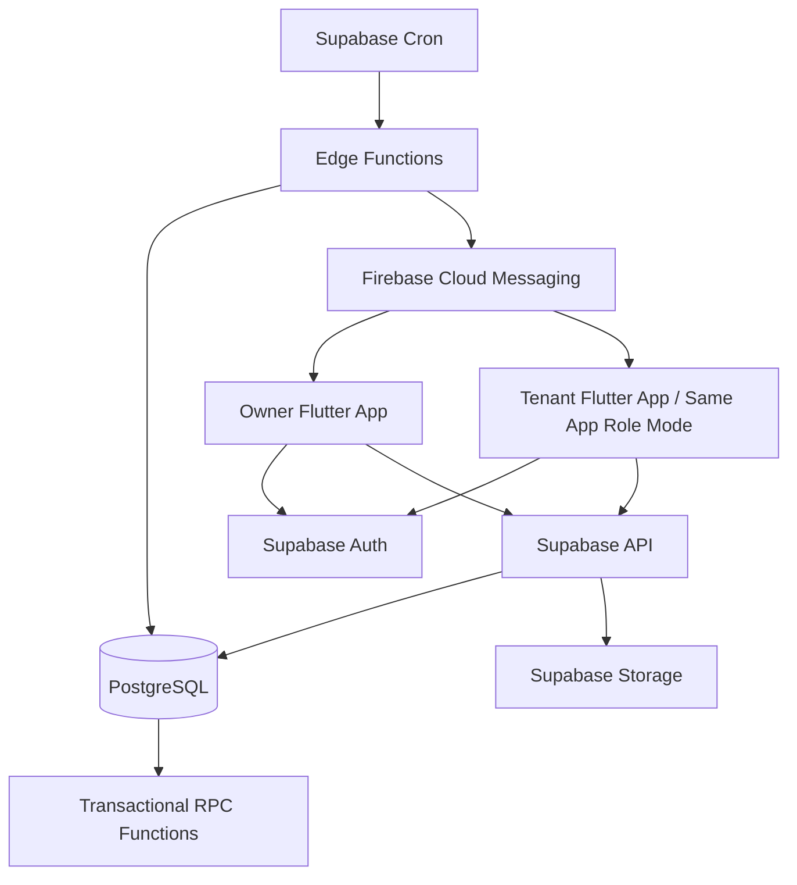

# 02 — Solution Architecture

## 1. Architecture overview

Use a modular Flutter application backed by Supabase. Keep the client thin: all financial posting and authorization-sensitive operations must be enforced in PostgreSQL policies/functions.



## 2. Recommended stack
- Flutter stable + Dart 3.x
- State management: Riverpod
- Navigation: `go_router`
- Backend: Supabase PostgreSQL, Auth, Storage, Edge Functions
- Data access: `supabase_flutter`; generated typed models with `freezed`/`json_serializable` if desired
- Forms: `flutter_form_builder` or standard controlled forms for small flows
- Local preferences: `shared_preferences` only for non-sensitive preferences
- Secure local storage: `flutter_secure_storage` for app-specific secrets if needed; Supabase session handling should follow SDK guidance
- Push: Firebase Cloud Messaging (FCM), Android notification channels
- Crash/error reporting: Firebase Crashlytics (decision: already using Firebase for FCM)
- Tests: `flutter_test`, `mocktail`, Supabase local development / pgTAP where practical
- CI: GitHub Actions (format, analyze, tests, build APK/AAB)

Pin dependency versions and commit `pubspec.lock` for the application.

## 3. Logical modules
1. Authentication & role resolution
2. Owner property/unit management
3. Tenant and agreement management
4. Rent schedule and obligation generation
5. Payment collection and receipt
6. Financial ledgers (security deposit, prepaid rent, tenant credit)
7. Rent adjustment ledger
8. Agreement/document management
9. Notification preferences and inbox
10. Dashboard and reports
11. Audit log and settings

## 4. Flutter architecture
Use feature-first clean architecture with pragmatic boundaries:

```text
lib/
  app/
    app.dart
    router.dart
    theme/
    localization/
  core/
    config/
    errors/
    result/
    money/
    dates/
    formatting/
    widgets/
    services/
  features/
    auth/
      data/ domain/ presentation/
    dashboard/
      data/ domain/ presentation/
    properties/
      data/ domain/ presentation/
    units/
      data/ domain/ presentation/
    tenants/
      data/ domain/ presentation/
    agreements/
      data/ domain/ presentation/
    rent_obligations/
      data/ domain/ presentation/
    payments/
      data/ domain/ presentation/
    deposits/
      data/ domain/ presentation/
    adjustments/
      data/ domain/ presentation/
    agreements/
      data/ domain/ presentation/
    notifications/
      data/ domain/ presentation/
    reports/
      data/ domain/ presentation/
  main.dart
```

Feature layers:
- `presentation`: screens, widgets, Riverpod providers/notifiers.
- `domain`: entities, repository interfaces, use cases, validation.
- `data`: Supabase DTOs, mappers, repository implementations.
Do not create an abstract use case for every trivial CRUD call. Keep complexity proportional to business risk.

## 5. Backend structure
Supabase project:
```text
supabase/
  config.toml
  migrations/
    0001_extensions_and_enums.sql
    0002_profiles_properties_units.sql
    0003_tenants_agreements.sql
    0004_rent_obligations.sql
    0005_financial_ledger.sql
    0006_notifications_and_audit.sql
    0007_rls_policies.sql
    0008_rpc_functions.sql
  functions/
    send-push-notifications/
    generate-monthly-obligations/
    send-monthly-reminders/
    send-agreement-expiry-reminders/
  seed.sql
  tests/
```

## 6. Data flow
### Payment posting
1. Flutter loads outstanding obligations from Supabase.
2. Owner selects target month/unit obligations and enters amount/method.
3. Client validates input for usability only.
4. Client calls a secured PostgreSQL RPC with an idempotency key and explicit allocation lines.
5. RPC locks target rows, validates owner scope and remaining balances, inserts payment and allocation records atomically.
6. RPC returns receipt and updated balances.
7. Client refreshes relevant providers.

### Scheduled notifications
1. Supabase Cron invokes an Edge Function on day 1 (Asia/Dhaka).
2. Function queries eligible obligations/agreements.
3. It inserts notification event rows using a unique deduplication key.
4. It sends FCM only for newly inserted events.
5. Delivery outcomes are stored; failed sends can be retried without creating duplicate logical events.

## 7. Important architecture decisions
- PostgreSQL is authoritative; never calculate financial truth only in Dart.
- Money is integer minor units (recommended paisa) or integer BDT, never `double`.
- Rent obligations are snapshots. Rent changes do not rewrite past months.
- Payment allocation is explicit and many-to-many. Support manual allocation and owner-approved oldest-due-first allocation; retain excess cash as tenant credit.
- Deposit is separate from rent income.
- Financial records are append-only; use reversals.
- RLS is mandatory for all tenant-accessible tables and Storage objects.
- Edge Function service-role key is server-side only. Never embed it in Flutter.
- Use database functions for atomic multi-table writes.
- Use UTC timestamps for event timestamps; use `date` for local billing dates and `Asia/Dhaka` for schedule interpretation.

## 8. Security boundaries
- Owner can access records where `owner_id = auth.uid()` (or via membership table if later multi-user).
- Tenant can access records only when `tenant_id` maps to their authenticated profile.
- Tenant cannot set their own `tenant_id`, `owner_id`, payment, adjustment or deposit values.
- Do not expose service-role credentials in app config, remote config, logs or source control.
- Use private Storage buckets for agreements and receipts; signed URLs with short expiry.
- Rate-limit invite, auth and notification endpoints where applicable.

## 9. Deployment environments
- Separate Supabase projects for development, staging and production.
- Flutter flavors: `dev`, `staging`, `prod`.
- Keep project URL and anon/publishable key in flavor-specific build configuration; anon key is not a secret, but RLS must protect data.
- Apply migrations through CI or controlled release process.
- Back up production before schema/data migrations.


## 10. Confirmed architecture decisions
- **No unit cap:** There is no product-defined limit on properties or units; do not implement quota logic.
- **Three distinct balances:** `security_deposit`, `prepaid_rent`, and `tenant_credit` must not be combined into one generic advance balance.
- **Allocation strategies:** Manual allocation and oldest-due-first are both supported. The client may calculate a preview, but the server must validate and persist exact allocation lines transactionally.
- **Excess payment:** Payment receipt amount may exceed selected obligation allocations. The difference must create a tenant-credit ledger entry in the same transaction. The owner can later apply tenant credit to a selected obligation.
- **Agreement alerts:** Day-1 monthly expiry reminders go to the owner and linked tenant. Tenant notification is conditional on a verified tenant account and enabled device/notification preference.


## 11. Localization architecture (confirmed)
- Supported app locales: `bn_BD` (default) and `en` (secondary).
- Flutter localization stack: `flutter_localizations` + `intl` + generated localization classes from ARB files.
- Translation resources: `lib/l10n/app_bn.arb` and `lib/l10n/app_en.arb`; configure `l10n.yaml` and generated `AppLocalizations`.
- A `LocaleController`/Riverpod provider resolves the locale in this order: authenticated profile preference → persisted local preference for signed-out onboarding → Bangla default. Avoid device-language auto-selection overriding the confirmed Bangla default on first launch.
- Store `preferred_locale` per authenticated profile (`bn_BD` or `en`). Owner and tenant profiles are independent.
- Use a centralized formatting layer for date, month, amount, BDT currency and pluralization. Do not hand-format numbers or concatenate translated sentence fragments.
- Notification Edge Functions resolve each recipient's locale independently before selecting localized templates.
- PDF generation uses an embedded Bangla-capable font (e.g. Noto Sans Bengali) and a separately tested English font fallback.
- PostgreSQL remains locale-neutral: numeric amounts in minor units, ISO dates, UTC timestamps, stable enum keys and stable IDs. Localization is a presentation concern.


## 11. Implemented Flutter app shell & localization foundation (Phases 5 & 6)
- Bootstrapped Flutter 3.50 / Dart 3.14 project in repository root with `flutter_riverpod`, `go_router`, `supabase_flutter`, `flutter_localizations`, and `intl`.
- Bilingual localization generated from `lib/l10n/app_bn.arb` (default `bn_BD`) and `lib/l10n/app_en.arb` (`en`) into `lib/generated/l10n/app_localizations.dart`.
- Core utilities: `MoneyFormatter` (exact integer minor-unit paisa to BDT `৳` without `double`), `EnvConfig` (refuses `service_role` or `sb_secret_` keys), `ApiErrorMapper` (maps every `P0001` backend error code to Bangla/English strings), `LocaleController` (defaults to `bn_BD` on first launch), `StatusBadge` (icon + text label + semantic color), `AsyncStateView` (loading/empty/error/retry), and `SeparateFundCards` (three distinct cards for Security Deposit, Prepaid Advance Rent, and Tenant Credit).
