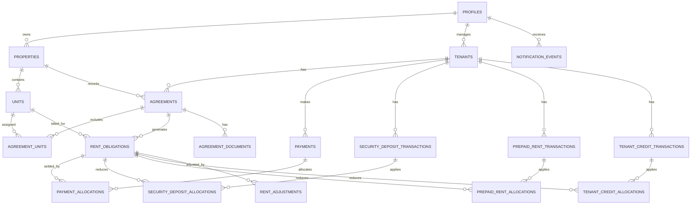

# 03 — Data Model and ERD

## 1. ERD



## 2. Entity definitions

### profiles
- `id uuid primary key references auth.users(id)`
- `full_name text not null`
- `phone text`
- `role text not null check (role in ('owner','tenant'))`
- `created_at timestamptz`
Role should be assigned by a trusted owner invitation/administrative flow, not accepted from arbitrary client input.

### properties
- `id uuid primary key`
- `owner_id uuid not null references profiles(id)`
- `name text not null`
- `address text`
- `currency_code text not null default 'BDT'`
- `timezone text not null default 'Asia/Dhaka'`
- `created_at`, `updated_at`
MVP may enforce one property per owner in UI; schema can support more.

### units
- `id uuid primary key`
- `property_id uuid not null references properties(id)`
- `owner_id uuid not null`
- `unit_code text not null`
- `floor_label text`
- `description text`
- `status text check (status in ('available','occupied','inactive'))`
- unique `(property_id, unit_code)`

### tenants
- `id uuid primary key`
- `owner_id uuid not null`
- `profile_id uuid null references profiles(id)` — null until tenant portal is activated
- `full_name text not null`
- `phone text not null`
- `email text`
- `address text`
- `notes text`
- `created_at`, `updated_at`
- unique partial index on `(owner_id, profile_id)` where profile_id is not null
A tenant profile must be linked through a verified invite/claim process. Do not let a tenant choose another tenant record by supplying an ID.

### agreements
- `id uuid primary key`
- `owner_id uuid not null`
- `property_id uuid not null`
- `tenant_id uuid not null references tenants(id)`
- `status text check (status in ('draft','active','ended','terminated'))`
- `billing_mode text check (billing_mode in ('advance','arrears'))`
- `due_day smallint not null check (due_day between 1 and 28)`
- `grace_days smallint not null default 0`
- `agreement_start_date date`
- `agreement_expiry_date date`
- `agreement_file_path text`
- `start_date date not null`
- `end_date date`
- `created_at`, `updated_at`
A tenant may have multiple concurrent agreements; do not add a one-active-agreement-per-tenant unique index. Non-overlap is enforced per unit on agreement_units.

### agreement_units
- `id uuid primary key`
- `owner_id uuid not null`
- `agreement_id uuid not null references agreements(id)`
- `unit_id uuid not null references units(id)`
- `monthly_rent_minor bigint not null check (monthly_rent_minor >= 0)`
- `currency_code text not null default 'BDT'`
- `start_date date not null`
- `end_date date`
- `created_at`
- Prevent overlapping active date ranges for the same unit using an exclusion constraint on daterange if supported/configured, or a trigger/transactional validation.
Rent amount is stored in minor units. For BDT, 1 BDT = 100 paisa. If the business only accepts whole taka, enforce multiples of 100.

### rent_obligations
One row per agreement + unit + billing month.
- `id uuid primary key`
- `owner_id uuid not null`
- `tenant_id uuid not null`
- `agreement_id uuid not null`
- `unit_id uuid not null`
- `billing_month date not null` — always first day of the month
- `due_date date not null`
- `base_rent_minor bigint not null`
- `created_at`
- unique `(agreement_unit_id, billing_month)`; recommended include `agreement_unit_id` FK or store it explicitly.
- `status` may be a derived view rather than source-of-truth column.

### payments
- `id uuid primary key`
- `owner_id uuid not null`
- `tenant_id uuid not null`
- `payment_date date not null`
- `amount_minor bigint not null check (amount_minor > 0)`
- `method text not null`
- `reference_no text`
- `note text`
- `receipt_no text not null`
- `idempotency_key uuid not null`
- `created_by uuid not null`
- `created_at`
- unique `(owner_id, idempotency_key)`
Payment represents money received from tenant. Allocation rows determine which rent months it settles.

### payment_allocations
- `id uuid primary key`
- `owner_id uuid not null`
- `payment_id uuid not null references payments(id)`
- `rent_obligation_id uuid not null references rent_obligations(id)`
- `amount_minor bigint not null check (amount_minor > 0)`
- unique `(payment_id, rent_obligation_id)`
The sum of allocations must not exceed payment amount or obligation's outstanding amount. Enforce inside a transaction/RPC; ordinary CHECK constraints cannot validate cross-row sums.

### security_deposit_transactions
Append-only refundable security-deposit ledger:
- `id uuid primary key`
- `owner_id uuid not null`
- `tenant_id uuid not null`
- `transaction_type text check (transaction_type in ('received','refund','applied','reversal'))`
- `amount_minor bigint not null check (amount_minor > 0)`
- `transaction_date date not null`
- `description text`
- `reference_no text`
- `reverses_transaction_id uuid null`
- `created_by uuid not null`
- `created_at timestamptz`
Security deposit application to rent is allowed only with explicit owner authorization and a recorded reason/agreement basis. Its balance remains separate from prepaid rent and tenant credit.

### security_deposit_allocations
- `id uuid primary key`
- `owner_id uuid not null`
- `security_deposit_transaction_id uuid not null references security_deposit_transactions(id)`
- `rent_obligation_id uuid not null references rent_obligations(id)`
- `amount_minor bigint not null check (amount_minor > 0)`
Only authorized application entries reduce an obligation. Refunds reduce the refundable security balance.

### prepaid_rent_transactions
Append-only prepaid rent ledger:
- `id uuid primary key`
- `owner_id uuid not null`
- `tenant_id uuid not null`
- `transaction_type text check (transaction_type in ('received','applied','refund','reversal'))`
- `amount_minor bigint not null check (amount_minor > 0)`
- `transaction_date date not null`
- `description text`
- `reference_no text`
- `reverses_transaction_id uuid null`
- `created_by uuid not null`
- `created_at timestamptz`
Prepaid rent represents money explicitly received for future rent. It is not security deposit.

### prepaid_rent_allocations
- `id uuid primary key`
- `owner_id uuid not null`
- `prepaid_rent_transaction_id uuid not null references prepaid_rent_transactions(id)`
- `rent_obligation_id uuid not null references rent_obligations(id)`
- `amount_minor bigint not null check (amount_minor > 0)`
Applying prepaid rent settles the selected future/current shop-month obligation.

### tenant_credit_transactions
Append-only tenant-credit ledger:
- `id uuid primary key`
- `owner_id uuid not null`
- `tenant_id uuid not null`
- `source_payment_id uuid null references payments(id)`
- `transaction_type text check (transaction_type in ('created_from_overpayment','applied','refund','reversal','manual_credit'))`
- `amount_minor bigint not null check (amount_minor > 0)`
- `transaction_date date not null`
- `description text`
- `created_by uuid not null`
- `created_at timestamptz`
An overpayment creates a credit entry in the same database transaction as the payment and its rent allocations.

### tenant_credit_allocations
- `id uuid primary key`
- `owner_id uuid not null`
- `tenant_credit_transaction_id uuid not null references tenant_credit_transactions(id)`
- `rent_obligation_id uuid not null references rent_obligations(id)`
- `amount_minor bigint not null check (amount_minor > 0)`
Credit applications settle explicitly selected shop-month obligations. Keep tenant credit distinct from prepaid rent in reporting and audit history, even if the owner later chooses to convert one balance category into another through a recorded transaction.

### rent_adjustments
- `id uuid primary key`
- `owner_id uuid not null`
- `rent_obligation_id uuid not null references rent_obligations(id)`
- `adjustment_type text check (adjustment_type in ('credit','debit','reversal'))`
- `amount_minor bigint not null check (amount_minor > 0)`
- `description text not null`
- `adjustment_date date not null`
- `created_by uuid not null`
- `reverses_adjustment_id uuid null`
Credit reduces payable; debit increases payable.

### notification_events
- `id uuid primary key`
- `owner_id uuid not null`
- `recipient_profile_id uuid not null references profiles(id)`
- `tenant_id uuid`
- `event_type text not null`
- `reference_id uuid not null`
- `billing_month date`
- `scheduled_for date not null`
- `dedupe_key text not null unique`
- `status text check (status in ('pending','sent','failed','skipped'))`
- `sent_at timestamptz`
- `failure_reason text`
- `created_at`

### device_tokens
- `id uuid primary key`
- `profile_id uuid not null references profiles(id)`
- `fcm_token text not null unique`
- `platform text not null`
- `active boolean not null default true`
- `updated_at timestamptz`

### audit_logs
- `id uuid primary key`
- `owner_id uuid not null`
- `actor_profile_id uuid not null`
- `entity_type text not null`
- `entity_id uuid not null`
- `action text not null`
- `before_data jsonb`
- `after_data jsonb`
- `created_at timestamptz not null default now()`
Do not log secrets or unnecessary sensitive tenant details.

## 3. Financial calculation model

For one rent obligation:
```text
net_payable =
  base_rent
  + sum(debit_adjustments)
  - sum(credit_adjustments)

outstanding =
  max(0,
    net_payable
    - sum(payment_allocations)
    - sum(prepaid_rent_allocations)
    - sum(tenant_credit_allocations)
    - sum(authorized_security_deposit_allocations)
  )
```
If credits exceed rent, do not silently discard the difference. MVP should reject an adjustment that would make net payable negative; alternatively introduce a separate tenant-credit ledger in a later release.

## 4. Reporting definitions
- **Expected rent:** sum of base rent for obligations in the selected billing month.
- **Adjusted payable:** expected rent + debit adjustments - credit adjustments.
- **Cash collected:** sum of payment amounts received in the selected payment-date range (not deposit receipts).
- **Rent settled:** payment allocations + deposit allocations applied to selected obligations.
- **Outstanding:** sum of obligation outstanding for selected billing months.
- **Security deposit balance:** receipts less refunds and explicitly authorized applications; report separately and do not count as rent income.
- **Prepaid rent balance:** prepaid-rent receipts less allocations/refunds.
- **Tenant credit balance:** excess-payment/manual credits less allocations/refunds.
- Reports must distinguish payment date from billing month. A December payment may settle November rent.

## 5. Indexes and constraints
- Index all `owner_id`, `tenant_id`, `billing_month`, `due_date`, `payment_date`, `profile_id`.
- Composite index `(owner_id, billing_month)` on obligations.
- Composite index `(tenant_id, billing_month)` for tenant portal.
- Unique idempotency key for payment posting.
- Unique notification dedupe key.
- Use foreign keys and `ON DELETE RESTRICT` for financial records.
- Soft archive operational records; do not cascade-delete financial history.


## 6. Confirmed model decisions and constraints
- No unit capacity rule: there is no maximum unit count and no quota column, trigger or function.
- Payment overage: `payments.amount_minor` may exceed the sum of rent allocations. The difference must equal a tenant-credit creation entry in the same transaction.
- Allocation strategies are UI conveniences only. The server receives exact allocation rows and validates them; oldest-due-first is computed against a locked, ordered set of eligible obligations.
- Keep three independent balances: security deposit, prepaid rent, and tenant credit. Do not expose one generic “advance balance”.
- Agreement expiry notifications target owner and linked tenant profiles, deduplicated per recipient/agreement/month.


## 7. Profile localization field
Add to `profiles`:
- `preferred_locale text not null default 'bn_BD' check (preferred_locale in ('bn_BD','en'))`
If existing rows are migrated, backfill `bn_BD`. Owner and tenant preferences belong to their own authenticated profile rows. Do not put one shared locale setting on the property or agreement.

## 8. Locale-neutral persistence rules
- Store currency as integer minor units (BDT poisha) and currency code `BDT` where needed.
- Store billing periods as canonical year/month or first-of-month `date`; store due dates as `date`.
- Store event timestamps as `timestamptz` in UTC.
- Store stable status/type keys (e.g. `paid`, `partial`, `due`) rather than Bangla or English labels.
- Never store formatted values such as `৳১২,৫০০` or localized month names in financial columns.


## Addendum: migration 0007
- `agreements.security_deposit_application_allowed` (default false, amendable term). Ledger rows are shape-constrained: `applied` rows must reference an obligation, reversal rows must reference an original entry, deposit rows require an agreement. `fund_operations` stores idempotency results for ledger RPCs.


## Addendum: migration 0009 (move-out & historical occupancy)
- `no_overlapping_active_unit_occupancy` on `agreement_units` now covers `status in ('planned', 'active', 'ended')` so a re-let agreement can never back-date into an ended assignment's historical date range.
- `move_out_settlements` adds `idempotency_key` and `settled_agreement_unit_ids uuid[]` and is append-only.
- Triggers block hard `DELETE` on `agreements`, `agreement_units`, `rent_obligations`, `tenants`, `units`, and `properties`, and block any `UPDATE` on `agreement_units` once `status = 'ended'`.
